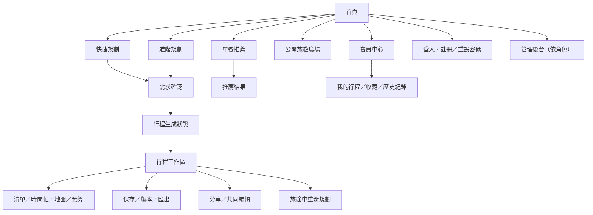
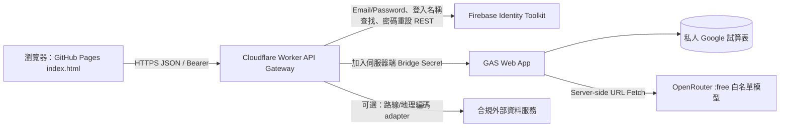

# AI 旅遊規劃與社群 App 產品規格書

**文件版本：** v1.0  
**文件日期：** 2026-10-09（Asia/Taipei）  
**產品範圍：** 第一版完整產品規格；台灣優先，預留全球擴展  
**主要讀者：** 產品負責人、AI 開發代理、前後端工程師、測試工程師、維運管理者  
**文件狀態：** 可進入「技術原型閘門」；正式大規模實作前，必須通過本文定義的 P0 原型驗收。

> **核心決策提醒**：功能需求完整列入第一版，不代表所有需求都能在純 GitHub Pages + GAS + Google 試算表的架構下安全可靠實現。本文保留所有產品需求，並把技術阻礙、建議的零成本替代架構、限制與驗收閘門明確分開。凡未通過原型測試的能力，一律不得標記為已實作或已驗收。

---

# 文件 1：產品總覽與需求摘要

## 1.1 產品願景

建立一個以 AI 為規劃助理的旅遊規劃與社群平台，讓旅客能收集需求、產生單餐推薦或多日行程、以地圖與時間軸編輯、在旅途中因應變化重新規劃，並安全地保存、匯出、分享及共同編輯行程。

產品不是訂票、訂房或交通營運商。AI 產出的行程是「建議草案」，只有能以可靠來源驗證的資料才能標示「已查證」。沒有可靠即時資料時，不得顯示為已確認的營業、庫存、班次、訂位、空房、人潮或交通狀態。

## 1.2 目標使用者與主要工作

| 使用者 | 主要工作 | 成功結果 |
|---|---|---|
| 訪客 | 瀏覽公開行程、試用有限次 AI 規劃 | 可體驗核心價值，清楚知道匿名行程保存限制 |
| 會員 | 建立、保存、編輯、匯出和分享自己的行程 | 行程資料不因失敗而無聲遺失，私人資料有權限保護 |
| 共享檢視成員 | 讀取被邀請的私人行程 | 只能讀取授權的行程與公開範圍 |
| 共享編輯成員 | 共同編輯已授權行程 | 修改有版本、修改者紀錄，衝突不會被默默覆蓋 |
| 一般管理員 | 處理檢舉與內容違規 | 權限僅限獲授權的日常管理功能，操作可稽核 |
| 最高管理員 | 管理模型、額度、系統開關及管理員權限 | 可調整營運策略，但不能讀取密碼或秘密憑證 |
| 網站維運者 | 部署、備份、配額監控、金鑰輪替 | 有明確復原程序，能辨識免費服務耗盡與外部故障 |

## 1.3 產品原則

1. **隱私預設保護**：行程預設私人；公開、指定會員可看須由擁有者明確選擇。
2. **AI 不等於事實**：AI 候選資料與外部查證資料分開儲存與呈現。
3. **修改範圍可控**：局部重新生成只允許修改指定範圍，除非使用者明確批准擴大影響。
4. **所有權在後端判斷**：前端傳來的 `UserID`、`OwnerID`、`Role`、`IsPublic` 皆不可信。
5. **免費用量失效即停，不轉付費**：模型或服務到額度、無法證明零成本或不符合白名單時直接拒絕請求。
6. **操作狀態誠實**：未完成儲存不可顯示成功；外部狀態未知要標示待確認。
7. **功能完整，分批交付**：模組可分批開發和測試，但第一版只能在全部必要模組通過驗收後宣告完成。
8. **先解決架構風險**：跨域、安全認證、資料一致性、費用保護必須在 UI 大量開發前通過原型測試。

## 1.4 第一版的成功標準

- 所有需求追蹤矩陣中的 `P0/P1` 必要需求均已實作，且對應驗收案例通過。
- 未授權讀取或修改私人行程的安全測試全部阻擋。
- 在兩個會員同時修改同一行程時，系統能偵測版本衝突並避免靜默覆蓋。
- 模型呼叫只能使用經驗證、白名單中的免費模型；無法證明零成本時阻擋呼叫。
- 外部資料缺失、模型失效或配額耗盡時，已保存行程仍可手動讀取、編輯與匯出（雲端整體故障時，僅能保證使用者事先下載的離線檔案可讀）。
- 部署、備份、復原、回版與金鑰輪替流程由非原作者依手冊演練成功。
- 每項測試都有執行記錄；未執行的案例不能標成通過。

## 1.5 建議技術決策總表

| 項目 | 建議方案 | 是否改動原始預期 | 決策理由／限制 |
|---|---|---|---|
| 靜態前端 | GitHub Pages，單頁式 `index.html` + `asset/` | 否；但需確認 Pages 使用政策 | 適合靜態檔案；不適合存放任何秘密。公開 SaaS 之使用範圍須再依 GitHub Pages 政策確認。 |
| 瀏覽器 API 入口 | Cloudflare Worker Free 作為 CORS/API 閘道 | 是，增加一個免費服務 | Worker 可控制 CORS 回應標頭，將 GAS URL 與內部呼叫憑證隱藏在瀏覽器之外；受免費配額及 CPU 限制。 |
| 業務邏輯與資料 | GAS Web App + 私人 Google 試算表 | 基本保留 | 低成本，但限額、執行時間與併發使其只適合初期小規模使用。 |
| 電子郵件／密碼認證 | Firebase Authentication Email/Password（不是 Google OAuth）；Worker/GAS 再建立七天應用工作階段 | 是，替代純 GAS 自建密碼系統 | 避免自行實作密碼儲存與重設寄信流程。Firebase Spark 的重設密碼郵件額度也有限，必須監控及降級。 |
| 行程資料庫 | Google 試算表 | 否 | 初期可行但不是高併發資料庫。以版本號、鎖定、冪等鍵與容量預警控制風險。 |
| AI | OpenRouter 指定 `:free` 模型白名單 | 否 | 不用動態任意模型；無法驗證免費身分或模型失效時停止請求。 |
| 地圖 | Leaflet + OSM 資料／符合政策的圖磚供應商 | 是，將開放資料與圖磚供應分開 | `tile.openstreetmap.org` 不可用作離線圖磚下載，不能假設不限流量。 |
| 地理編碼 | 以使用者主動搜尋、快取與速率限制為主；優先評估合規的台灣地點資料 | 否 | 公共 Nominatim 有明確使用限制，不可為每個行程項目大量批次查詢。 |
| 路線 | OSM 衍生服務或外部可用資料，經來源介面抽象化 | 否 | 不保證全球、即時交通或大眾運輸都有免費服務。缺資料時提供 Google Maps 連結與待確認狀態。 |
| 離線 | 下載行程 JSON／Markdown／ICS／列印 PDF；可選 PWA 快取 UI | 否 | 離線行程資料不等同完整離線地圖。完整離線地圖需另有授權的圖磚來源。 |

---

# 文件 2：完整產品需求規格書（PRD）

## 2.1 使用者角色與權限矩陣

| 能力 | 訪客 | 會員／擁有者 | 共享檢視者 | 共享編輯者 | 一般管理員 | 最高管理員 |
|---|---:|---:|---:|---:|---:|---:|
| 瀏覽公開行程 | ✓ | ✓ | ✓ | ✓ | ✓ | ✓ |
| 有限次 AI 試用 | ✓（依額度） | ✓（依額度） | ✓（個人額度） | ✓（個人額度） | 依個人角色，不自動豁免 | 依個人角色，不自動豁免 |
| 保存私人行程 | — | ✓ | — | 只能保存到自己的副本 | — | — |
| 讀取指定私人行程 | — | 擁有者 | ✓ | ✓ | 除非檢舉處理流程授權，不得任意讀取 | 除非必要管理流程明確授權，不得任意讀取 |
| 修改行程 | — | ✓ | — | ✓，限授權行程及編輯權 | 僅內容治理相關操作 | 依明確管理功能 |
| 公開／取消公開 | — | ✓，僅自己擁有 | — | 否，除非擁有者另有授權且規格允許 | 可依治理政策隱藏內容，但不可代替作者公開 | 同左，並可管理系統設定 |
| 按讚／留言／收藏 | 登入前不可 | ✓ | ✓（登入會員） | ✓（登入會員） | 依個人一般會員功能 | 依個人一般會員功能 |
| 處理檢舉 | — | — | — | — | ✓ | ✓ |
| 指派管理員／調整模型與額度 | — | — | — | — | — | ✓ |
| 讀取密碼／重設秘密／API 金鑰 | — | — | — | — | — | **一律不可** |

**後端判斷規則：** `role`、`uid`、`ownerId`、可見性、編輯權皆取自伺服器端已驗證資料。只有通過授權檢查後，才能讀取資源內容；不得先把內容讀出再只在前端隱藏。

## 2.2 核心功能需求

### FR-001 首頁與導覽
- 首頁顯示產品定位、快速規劃、進階規劃、單餐推薦、多日行程、公開旅遊廣場、公開行程精選、會員登入／註冊、免費額度說明、資料可信度原則與隱私提醒。
- 訪客可以瀏覽公開內容及使用有限 AI 額度；保存、收藏、按讚、留言需登入。
- 導覽必須在手機版折疊為可操作的選單；鍵盤可操作並有焦點樣式。
- 顯示服務狀態：`正常`、`部分功能降級`、`AI 暫停`、`服務維護`。這些狀態必須由後端狀態查詢取得，不得寫死為「正常」。

### FR-002 快速規劃與進階需求收集
- 快速模式必要欄位：目的地、日期或天數、旅遊人數、出發地／交通方式可略過但需提醒會影響時間計算、預算可略過但標示未設定。
- 進階模式可填：幣別、興趣、餐飲偏好、過敏／禁忌、無障礙、每日步行距離、節奏、必去、排除、已確認訂單、不可用項目及自由文字限制。
- 採逐步追問。每次最多詢問三個相關問題；非必要問題可略過。若缺少目的地或日期／天數等核心資料，先問清楚再生成。
- 飲食過敏屬敏感且可能高風險資訊；只蒐集必要條件，不做醫療判斷。回傳餐廳建議必須提醒使用者向店家確認交叉污染及最新成分。

### FR-003 單餐美食推薦
- 可輸入地區、用餐日期／時段、預算、料理、口味、同行人數、飲食限制、無障礙及交通偏好。
- 每個推薦項目提供名稱、地址／座標、特色／菜系、預估價格、營業時間（若可靠來源可取得）、地圖、路線（可用時）、來源 URL、驗證狀態、查證時間、官方訂位／資訊連結（若可查）。
- 缺乏來源的價格標記「AI 估算」；沒有可驗證的營業時間則顯示「請向店家確認」，不得捏造時間。
- 推薦至少包含候選與替代選項；若資料不足，降低推薦確定性並說明原因。

### FR-004 多日行程生成
- 支援簡易版與詳細版。
- 可包含早餐、上午活動、午餐、下午活動／茶點、晚餐、住宿、交通、移動時間、單日與全程預算。
- 每個項目都有穩定 `itemId`、`dayId`、時間、類型、位置、移動與預算欄位；不得使用陣列索引當 ID。
- 時區預設為目的地 IANA 時區；台灣以 `Asia/Taipei`。輸入時間需按本地日期解讀並儲存 ISO 8601 與時區識別。
- 交通及停留時間均標示為估算或已查證。未接入即時資料前，不呈現即時交通／票券可用狀態。

### FR-005 必去、排除、鎖定及衝突
- 必去項目以 `mustVisit=true` 記錄；排除項目存於 `excludedPlaces[]`；鎖定項目 `locked=true`；已完成項目 `status=completed`；已確認訂單 `reservationStatus=confirmed` 且另記錄不可修改的欄位。
- AI 提案不得刪除或更動鎖定項目、已完成項目及未經使用者明確授權的已確認預約。
- 衝突包含公休／關閉、移動時間不合理、售罄、訂滿、無法訂位、超支、步行超限、無障礙不符及輸入矛盾。
- 衝突處理回傳 `conflicts[]` 與候選解法；重大衝突時只提出方案，不直接套用。

### FR-006 地圖與路線
- 以 Leaflet 為主要地圖 UI 候選；地圖資料與圖磚供應來源分離，歸屬標示常駐可見。
- 支援地點標記、按日顯示、景點順序、可用時的步行／騎車／駕車路線。大眾運輸與即時交通僅在有授權、可用、覆蓋該區資料時提供。
- 路線缺失時仍顯示地點清單、座標／地址和 Google Maps 搜尋或路線連結。
- 前端快取只能遵守圖磚供應商規則；不得對 OSM 官方圖磚做預先下載、區域打包或離線地圖功能。

### FR-007 旅行當下調整
- 行程工作區顯示當日時間軸、目前／下一活動、地圖、交通方式、預算餘額、待確認項目。
- 使用者可回報趕不上交通、延誤、排隊過久、人潮太多、關閉／無法進入、想略過或改變偏好。
- AI 只重新計算尚未完成的行程；已完成、鎖定及已確認預訂項目受到保護。
- 回傳調整前後差異、原因、時間與預算影響、資料來源及未確認項目。使用者按「套用變更」後才更新正式行程。
- 不要求第一版自動監控交通或排隊時間；不得暗示系統在背後持續追蹤。

### FR-008 行程工作區與局部修改
- 至少含清單、地圖、時間軸、每日／全程預算四種視圖。
- 支援新增、刪除、拖曳排序、修改、替換景點／餐廳／住宿、局部重新生成、指定日重新生成、對話修改、替代方案、鎖定、復原、版本還原及重新計算。
- 局部修改請求包含 `scope.itemIds` 或 `scope.dayIds`、`baseVersion`、不可修改項目快照及接受的衝突策略。
- 後端套用模型 patch 前比對版本。除 scope 外的項目必須在結果中逐欄相等（允許伺服器更新 `updatedAt`、版本欄位及派生計算欄位）。如有非預期更動，拒絕套用並回傳 `AI_SCOPE_VIOLATION`。

### FR-009 儲存與版本
- 會員行程預設私人；訪客行程只可存在目前裝置記憶體／明確下載的草稿，不宣稱永久保存。
- 支援自動儲存及手動儲存。每次寫入使用 `baseVersion`、`idempotencyKey`，由後端原子檢查版本後寫入。
- 使用者看得到「儲存中／已儲存／儲存失敗／等待同步／版本衝突」。成功狀態只能在伺服器回覆成功且版本已更新後顯示。
- 重要修改保存完整 `TripVersions` 快照及差異摘要；版本還原建立新版本，不直接刪除或覆寫歷史紀錄。

### FR-010 共享編輯
- 擁有者可邀請會員為 `viewer` 或 `editor`；邀請狀態包括 `pending/accepted/revoked/expired`。
- 公開行程讀者不可修改原作者行程；複製公開行程會產生新的 `TripID`、新的所有權及 `forkedFromTripId`。
- 編輯時使用樂觀併發控制；版本不匹配回傳 `VERSION_CONFLICT`、目前版本摘要及重新載入選項。不做無法保證的即時同步宣稱。
- 撤銷成員權限必須立即阻止後續寫入；已送出的請求在鎖定區段再次檢查權限。

### FR-011 會員／認證
- 採用 Firebase Authentication Email/Password，但前端不得自行把 Firebase ID token 當成本產品的七天登入工作階段；所有登入、註冊、重設流程均由 Worker 代理呼叫 Firebase Identity Toolkit REST API，瀏覽器只收到本站 session token。不得強制使用 Google OAuth。
- 支援「唯一登入帳號名稱或電子郵件 + 密碼」。登入名稱與暱稱是不同欄位；`LoginNameNormalized` 必須唯一，後端查找登入帳號名稱時不得把 email 對照結果回傳給瀏覽器。
- Firebase UID 是穩定身分識別；登入成功後由 Worker 以 UID 請求 GAS 建立本站七天工作階段。`Sessions` 只存 session token verifier、`UserID`、期限及撤銷狀態；不保存 Firebase 密碼、原始 session token 或 Firebase refresh token。
- 工作階段有效期為建立後 7×24 小時；登出立即撤銷。密碼重設成功後，後端撤銷該使用者所有本站工作階段；使用者需重新登入。
- 註冊、登入與重設失敗採一般化回應及速率限制，避免洩漏帳號存在性。密碼重設可用 email 或登入名稱提出，但實際重設連結只寄到已註冊 email。
- GAS 純自建密碼方案列為替代方案，不可在未證明安全 KDF、CSPRNG、限流及效能前上線。

### FR-012 行程隱私與分享
- `visibility=private|public|restricted`。行程建立預設 `private`。
- `restricted` 必須以 `TripMembers`／授權表確認 UID，不可只依分享連結識別。
- 公開前顯示預覽，列出可能公開的住宿細節、私人備註、聯絡資訊及精確時間等。作者可逐項取消公開欄位。
- API 回傳公開 DTO 與私人 DTO 必須分離；前端 CSS 隱藏不算資料保護。

### FR-013 公開旅遊廣場與社群
- 支援公開行程清單、詳細頁、搜尋／篩選、作者公開頁、公開行程列表、複製、按讚、取消按讚、留言、刪除自己的留言、收藏、取消收藏、分享連結及檢舉。
- 按讚與收藏以 `(UserID, TripID)` 唯一；留言長度及頻率有上限；輸出使用純文字或經過可信 sanitizer 的內容，避免 XSS。
- 檢舉包含原因、目標資源、補充說明（可選）、狀態、處理管理員、處理原因及時間。

### FR-014 管理員後台
- 一般管理員僅能查看／處理檢舉、隱藏違規公開內容、處理垃圾留言及依政策處置違規帳號；每項處置必填原因。
- 最高管理員可指派／撤銷管理員、調整 AI 免費模型白名單與備援順序、操作額度、設定及全站 AI 緊急開關。
- 每次操作後端重新驗證角色，寫入 `AdminAuditLogs`。稽核 log 不得包含密碼、重設 token、session token、API 金鑰或完整敏感對話。
- 即使最高管理員也不得顯示或匯出明文認證秘密。

### FR-015 行程匯出
- 必須支援 PDF 列印版、可分享網頁、Google Maps 連結、ICS、純文字／Markdown、CSV／試算表、手機精簡版、一鍵複製完整行程與離線行程檔案。
- PDF 由瀏覽器列印樣式產出；若需伺服器 PDF 產生器，須另外評估零成本依賴。PDF 列印樣式需隱藏導覽、按鈕與私人內容中的不應公開欄位。
- ICS 需含 `UID`、`DTSTAMP`、`DTSTART`、`DTEND`、`SUMMARY`、`LOCATION`、`DESCRIPTION`、`TZID` 或 UTC 時間。若沒有結束時間，按活動類型預設合理時長並標記估計，不得把未知交通時間當成確定事件。
- CSV 欄位包含 TripID、日期、開始、結束、時區、類型、標題、地址、緯度、經度、交通、預算金額、幣別、驗證狀態與來源 URL。對以 `= + - @` 開頭的文字欄位使用 CSV formula injection 防護。
- 離線行程 JSON／Markdown 應包含時間、地址、座標、必要聯絡資訊（使用者選取後才納入）、來源與待確認事項；不含登入 session token、私人資料預設不得匯出到公開檔案。
- 離線檔案可讀不等同地圖離線；外部地圖仍需網路，除非另外採用明確授權的離線地圖來源。

### FR-016 AI 模型與額度
- 模型清單由後端設定。每個項目至少包含 ID、主要／備援順序、允許操作、最近免費資格查核時間、定價快照、健康狀態及啟用狀態。
- 只准使用精確白名單中的 `:free` 變體。對模型目錄查驗 prompt、completion、request 及涉及的多模態費用均為零；若定價資料不可取得、變成非零、模型不存在或 ID 未帶允許的免費變體，拒絕發送。
- 禁用付費 fallback；不得使用未受控的動態 free router 作為唯一選擇，因為模型選擇會變動且難以追蹤。備援必須是另一個精確白名單的免費模型。
- 訪客完整行程、會員完整行程、單餐推薦、局部修改、單日重生、整趟重生、途中重規劃分別計數。另有全站每日上限、單會員上限、併發上限與全站停用開關。
- 超額、限流、模型下架、JSON 不相容、費用驗證失敗時，保留已儲存資料與手動編輯功能，提示使用者稍後再試或以手動模式繼續。

### FR-017 來源可信度
- `sourceType` 可為 `official`、`licensed_provider`、`open_data`、`public_reference`、`ai_candidate`、`user_report`。
- `verificationStatus`：`verified`、`source_available_unverified`、`estimated`、`needs_confirmation`、`source_unavailable`、`possibly_stale`、`user_reported`、`error`。
- 每個重要資料項目有 `sourceUrl[]`、`checkedAt`、`isRealtime`、`isEstimate`、`confidenceNote`。
- AI 自行提出的地址、營業時間、價格、班次或訂位狀態預設不可標為已查證。
- 查證時間與來源資料不能只存在提示詞或自然語言中；必須使用結構化欄位。

### FR-018 帳號刪除與資料保留
- 使用者提交刪除申請後，先再次驗證身份並顯示後果；提供短暫撤銷期（建議 7 天，管理者可調整但必須公告）。
- 刪除時撤銷所有應用 session、行程邀請、收藏、按讚及個人關聯。私人行程原則上刪除；共享行程依政策移除使用者識別並由擁有者保留行程，作者名稱可轉為「已刪除使用者」。公開行程由使用者在刪除前選擇刪除或去識別保留；不得未告知就公開保留。
- 內容、操作稽核紀錄、備份分開設保留期。備份中的已刪資料可能在輪替週期內仍存在，需說明最長清除期限；恢復備份時必須重新套用刪除清單。

---

# 文件 3：功能模組規格

## 3.1 模組清單與輸入／輸出

| 模組 | 輸入 | 核心規則 | 輸出／失敗處理 |
|---|---|---|---|
| 會員認證 | Firebase Auth ID token、session token、登入／登出事件 | Worker 驗證 ID token；本站 session 在 GAS 驗證；UID 僅取自有效 token／session | 建立／撤銷 7 天 session；無效回 `AUTH_REQUIRED`，不可讀私人資料 |
| 需求蒐集 | 使用者回答、旅行限制 | 先補必填欄位；非必要可略過；過敏等資料最小蒐集 | `TripRequestDraft`；缺少核心條件時回傳下一個問題而不生成 |
| AI 代理 | 操作類型、已驗證使用者、輸入 DTO | 白名單模型、額度鎖定、requestId 冪等、超時與有限重試 | 經驗證 JSON；失敗回 `AI_UNAVAILABLE`／部分結果，不覆蓋正式資料 |
| 地點資料 | 名稱、地址、座標、來源 | 來源分層、快取、速率限制，無法查證不補造 | `Place` + 驗證紀錄；來源不可用時回待確認 |
| 行程編輯 | TripID、baseVersion、操作 patch | 權限、版本、鎖定項目、局部 scope 檢查 | 新版本與差異；衝突不覆蓋 |
| 社群 | TripID、留言／按讚／收藏／檢舉 | 公開內容與私人資源分離、唯一鍵、XSS 防護 | 社群紀錄；重複按讚採冪等結果 |
| 匯出 | 行程版本、範圍、隱私選項 | 匯出固定版本；隱私欄位過濾；ICS／CSV 格式驗證 | 可下載檔或可複製文字；明確顯示產生失敗 |
| 管理 | 管理操作、目標、原因 | 逐次授權；高權限操作稽核；二次確認破壞性操作 | 操作結果與 auditId；無權限回 `FORBIDDEN` |
| 備份／復原 | 備份工作、快照清單、執行者 | 加密／存取受控、備份完整性檢查、刪除墓碑重套用 | `BackupRecords`；失敗通知管理者，不假裝完成 |

## 3.2 行程衝突處理規則

衝突優先序如下：

1. **不可自動改動**：使用者已完成、已鎖定、已確認預訂且未授權修改的項目。
2. **不可違反的硬限制**：過敏與飲食禁忌、無障礙必要條件、使用者明確排除項目、日期、參與人數等。
3. **必去項目**：不能無聲刪除；如果時間無法安排，提出衝突與可選方案。
4. **預算與節奏偏好**：可計算偏差並提案調整，但需明示超支或超步行距離。
5. **一般偏好與 AI 最佳化**：在前述條件滿足後才調整。

`conflict.severity` 使用 `info|warning|blocking`。`blocking` 項目未經使用者確認前不可套用；`warning` 可提出方案，但須顯示差異。

## 3.3 自動儲存與版本衝突

- 前端 debounce 目標 800–1200 ms；切換頁面、開始生成或離開工作區時主動 flush，但不能依賴 `beforeunload` 保證完成。
- 每筆儲存都帶 `TripID`、`baseVersion`、`clientMutationId`、`patch`、`modifiedBy`（伺服器覆寫為真實 UID）。
- GAS 取得 `ScriptLock` 後重新讀取目前版本；只有 `baseVersion === currentVersion` 才套用。資料寫入、版本記錄及冪等鍵在同一個鎖定區段內完成，並儘量以批次 `setValues` 減少服務呼叫。
- 版本不符時回傳 `VERSION_CONFLICT` 與 `currentVersion`、可供比較的差異，不自動 retry 寫入相同 patch。
- `LockService` 只避免執行區段同時進入，不是資料庫交易；仍需設計版本檢查與寫入中斷修復。避免在持鎖期間呼叫 OpenRouter 或耗時外部 API。

## 3.4 AI 生成與修復

1. 驗證身分、額度、輸入大小、`requestId`、模型設定與系統開關。
2. 讀取必要行程基準版本和被保護項目。
3. 建立結構化提示詞，將使用者內容視為不可信資料，不讓其覆寫系統安全政策。
4. 呼叫明確的免費模型 ID；設定有限 `max_tokens`／逾時策略，不使用串流依賴來保證回應完整。
5. 解析 JSON；依 schema 驗證欄位、日期、金額、ID、項目數量與 scope。
6. 做確定性規則檢查：鎖定項目未改、excluded 項目未加入、總預算正確、時間沒有明顯倒置、每個 itemId 唯一。
7. 首次格式錯誤時最多再嘗試一次受限修復；修復請求仍須遵守相同免費模型政策，且計入實際請求額度。
8. 仍失敗時保留合法部分，但標記 `generationStatus=partial|failed`；未通過驗證的模型結果不可套用正式行程。
9. 回傳使用者可理解的原因代碼與待確認欄位，不把原始內部堆疊或秘密顯示給前端。

## 3.5 地圖與資料來源介面

所有外部資料服務採 adapter 介面，不讓核心行程模型直接依賴單一供應商：

- `Geocoder.search(query, region, limit)`
- `Places.lookup(placeId|coordinates)`
- `Routes.calculate(origin, destination, mode, departureTime?)`
- `Transit.lookup(origin, destination, localDateTime)`
- `BusinessHours.lookup(placeId, date)`
- `BookingAvailability.lookup(bookingUrl, date, partySize)`

每個 adapter 都回傳 `providerId`、`coverage`、`sourceUrl`、`checkedAt`、`isRealtime`、`verificationStatus`、`errorCode`。不能把「接口不存在」用靜態假資料填補。

---

# 文件 4：UI／UX 與頁面規格

## 4.1 資訊架構



## 4.2 共用視覺與互動規則

- 精緻、現代、成熟商業產品風格；優先清楚資訊層級與易讀性，不用裝飾犧牲資料可信度。
- 基礎版面使用 8pt spacing scale；正文 16px 為主，互動目標至少 44×44 CSS px；文字與背景對比需達 WCAG 2.2 AA 目標。
- 螢幕寬度：`<640px` 手機單欄；`640–1023px` 平板雙欄或底部切換；`>=1024px` 桌面工作區可採側欄＋主內容＋地圖。
- 地圖／時間軸不宜在手機同時搶占畫面；用底部 segmented control 切換「清單／地圖／時間軸」。
- 每個表單、按鈕和非同步區塊具備 loading、success、error、empty、disabled 狀態。錯誤提示需含可行動的下一步。
- 無障礙：鍵盤可操作、焦點可見、表單標籤關聯、錯誤訊息可被螢幕閱讀器讀取，不以顏色作為唯一狀態線索。
- 地點卡片內的來源與狀態固定位置呈現；「AI 推估」「待確認」不得以跟「已查證」相同的外觀混淆。

## 4.3 主要頁面規格

| 頁面 | 目的／使用者 | 區塊與欄位 | 核心操作 | 成功／失敗／載入 | 權限與響應式 |
|---|---|---|---|---|---|
| 首頁 | 新訪客與回訪者 | Hero、快速／進階規劃入口、推薦、公開行程、可信度說明、免費限制、隱私提示 | 開始規劃、搜尋公開內容、登入 | 依後端服務狀態顯示；載入空狀態可重試 | 全角色；手機單欄卡片 |
| 快速規劃 | 想快速起稿的人 | 地點、日期／天數、人數；預算／交通／興趣可選 | 下一步、略過選填、生成 | 缺核心欄位時顯示補問；生成中顯示階段 | 訪客／會員；手機分步表單 |
| 進階規劃 | 有明確限制的人 | 預算、幣別、飲食、無障礙、步行、必去／排除、已確認事項 | 儲存草稿、確認需求 | 欄位錯誤就地顯示；可保存草稿 | 訪客／會員；桌面分區表單 |
| 單餐推薦 | 找某地用餐選項 | 地區、用餐時段、人數、預算、口味、禁忌 | 搜尋、調整篩選、開地圖 | 來源不足提示；錯誤保留輸入 | 訪客／會員；手機結果卡片堆疊 |
| 行程工作區 | 編輯完整旅程 | 日分頁、清單、時間軸、地圖、每日總額、衝突面板、來源標示 | 新增／編輯／刪除／拖曳／鎖定／重生／復原／儲存 | 儲存狀態永遠可見；衝突以差異視圖呈現 | 會員／共享編輯者；手機分頁，桌面多欄 |
| 旅途中模式 | 當日快速查看 | 目前與下一活動、地址、移動方式、預算與待確認事項 | 回報延誤、略過、重新規劃 | 不可用資料顯示未知；套用前預覽 | 行程授權人；大按鈕、低干擾 |
| 會員中心 | 管理帳號和內容 | 暱稱、公開頁、我的行程、收藏、歷史、隱私 | 編輯資料、刪除行程、申請刪帳號 | 破壞性操作二次確認 | 僅本人；手機列表 |
| 登入／註冊 | 建立會員工作階段 | email、password、暱稱、驗證狀態 | 註冊、登入、登出 | 不洩漏帳號存在性；顯示速率限制 | 所有人；手機單欄 |
| 密碼重設 | 取回帳號 | email、重設連結頁、新密碼 | 要求寄信、確認新密碼 | 一律回覆相同請求訊息；憑證失效可重新申請 | 所有人；不把 token 顯示於頁面或 log |
| 公開旅遊廣場 | 發現他人行程 | 搜尋、目的地／天數／預算篩選、卡片、作者頁 | 查看、複製、按讚、留言、收藏、檢舉 | 空結果、載入、錯誤與重試 | 訪客可瀏覽；登入行為需驗證 |
| 分享預覽 | 避免不慎公開敏感資料 | 公開 DTO 預覽、欄位包含／排除選項、可見性 | 公開、指定會員、取消 | 明確顯示會公開什麼 | 僅擁有者；手機逐項勾選 |
| 協作管理 | 管理行程成員 | 成員列表、角色、邀請狀態、修改紀錄 | 邀請、接受、撤銷、改權限 | 權限撤銷後即時阻擋下一請求 | 擁有者／被授權管理者 |
| 管理後台 | 內容治理及營運設定 | 檢舉、模型白名單、額度、開關、管理員、稽核 | 隱藏內容、調額、切模型、停 AI | 設定變更要顯示稽核 ID；失敗不呈成功 | 一般／最高管理員分離 |
| 匯出 | 保存或分享行程 | 格式選擇、日期範圍、隱私包含選項 | 下載／複製／列印／產 ICS | 檔案大小或產生錯誤明確顯示 | 依行程權限；手機提供精簡版 |

## 4.4 必須具備的共用元件

- `SourceBadge`：資料來源類別、驗證狀態、查證時間。
- `QuotaNotice`：個人／訪客使用量、全站 AI 狀態、重置時間（若可查）。
- `SaveStatus`：儲存中、已儲存、失敗、待同步、版本衝突。
- `ConflictPanel`：衝突層級、理由、來源、選項、影響預覽、套用確認。
- `RouteStatus`：路線模式、資料來源、估算／已查證、地圖連結。
- `PrivateFieldToggle`：公開預覽中選擇是否包含備註、住宿細節、聯絡資訊等。
- `DestructiveActionDialog`：刪除、撤銷權限、刪帳號、公開等操作的再次確認。
- `ServiceHealthBanner`：AI、地圖、郵件、資料儲存的降級狀態。

---

# 文件 5：系統架構及技術可行性報告

## 5.1 查證方法與日期

以下查證以 **2026-10-09** 可取得的官方文件或原始維運政策為準。配額、模型清單、條款、服務能力都可能變更；上線前與每月維運時須重新查核。官方來源清單見本文件最後「技術來源」。

## 5.2 技術可行性與重大風險表

| 項目 | 結論 | 狀態 | 風險／規格決策 |
|---|---|---|---|
| GitHub Pages 靜態前端 | 可以提供 HTML/CSS/JS | 可行但有政策限制 | 任何秘密都不能放前端；GitHub Pages 有大小、頻寬等限制，官方政策也限制把 Pages 當免費商業 SaaS 主機。需確認本站實際用途；若不符，採免費 Cloudflare Pages 或其他合規靜態主機替代，先經專案擁有者接受。 |
| GitHub Pages 直接 `fetch()` GAS | 不能僅憑 GAS 公開 URL 保證可讀取跨域 JSON | 必須原型測試；純架構不建議直接上線 | GAS `ContentService` 會將內容放到不同 URL；`TextOutput` 沒有一般用途的任意 response-header API。CORS、302/重新導向、POST 內容型別、credentials 及手機 Safari/Chrome 行為需實測。推薦 Worker 作為前端 API 閘道。 |
| `google.script.run` | 僅適用於 GAS HtmlService 頁面中的用戶端程式，不是獨立 GitHub Pages 的 RPC | 不適用於既定前端 | 不得在 GitHub Pages 假裝有 `google.script.run`。 |
| Worker → GAS 代理 | 可在 Worker 控制 CORS 及把 bridge secret 注入伺服器端請求 | 可行但需原型測試 | GAS Web App 仍可被直接訪問，因此 GAS 必須要求內部 bridge secret；Worker 隱藏該 secret。對 CORS 而言，不可把 Origin 當身分驗證。 |
| GAS 自建密碼認證 | GAS Utilities 有 SHA/HMAC，但未提供直接的 Argon2id/PBKDF2 密碼 KDF API | **需要替代架構** | 不能用快雜湊充當密碼儲存。推薦 Firebase Auth Email/Password；若堅持自建，必須以 KDF、CSPRNG、限流與登入效能原型驗證作為 P0，不通過不得上線。 |
| 七天本站工作階段 | 可由 Worker 發 token 並在 GAS 保存 verifier／撤銷狀態 | 可行但有瀏覽器 token 風險 | 若採 GitHub Pages 與 api 子網域跨站部署，不能依賴 HttpOnly cookie 一定可用；建議 256-bit 隨機 bearer token 儲於 `localStorage`，後端每次驗證、可撤銷，並強化 CSP/XSS 防護。這是已知權衡；若可改成同站自有網域，可改 HttpOnly Secure SameSite Cookie。 |
| Firebase Auth Email/Password | 官方提供 email/password 登入、密碼重設；Spark 方案有配額限制 | 可行但有限制 | 不使用 Google OAuth。Spark 密碼重設郵件配額以查證當日官方文件為準（文件顯示 150 封／日）；超額即停止／提示，不可切付費。需要後端確認 UID 與本站 session 關聯。 |
| GAS MailApp 重設寄信 | 一般 Gmail 帳戶每日收件人額度 100；Workspace 常見 1,500，仍依官方變更 | 可行但有限制 | `MailApp.getRemainingDailyQuota()` 執行時檢查；不是保證送達。若採 Firebase Auth，該流程優先使用 Firebase 的原生重設流程，不另自建 `PasswordResetTokens`；GAS MailApp 保留為備用設計評估。 |
| OpenRouter 免費模型 | `:free` variant 代表免費入口，但供應與限額不同於付費模型 | 可行但有限制 | 查證官方免費方案顯示免費帳戶 50 requests/day、20 RPM（實際數字可能變）；只准精確 `:free` 模型白名單、查價後 fail closed、禁用 paid fallback。不得以 `openrouter/free` 動態路由作唯一可追溯模型策略。 |
| OSM 官方圖磚 | 一般互動式瀏覽可用但無 SLA；禁止離線預抓／批量下載 | 可行但有限制 | 顯示 attribution、遵守 cache headers、禁止整區下載與 `.mbtiles` 生成；流量一旦影響公共伺服器可能被封鎖。 |
| 公共 Nominatim | 適合低頻主動搜尋，不適合高流量批次地理編碼 | 可行但有限制 | 官方政策要求重度使用禁止、絕對最大每秒 1 次、有效 Referer／User-Agent 與 attribution。由前端直接查詢未必可符合所有要求；以後端快取、佇列、去重及替代供應商介面處理。 |
| 免費路線服務 | 依供應商、地區與資料種類而異 | 必須原型測試 | 不可假設步行、騎車、開車、公共運輸、即時交通都涵蓋台灣全區或全球。MVP 只在確認可用時顯示路線。 |
| Google 試算表 + GAS | 小規模資料可行；不是交易型／即時同步 DB | 可行但有限制 | 使用鎖定、版本號、冪等、防批次讀寫、索引欄位與備份。不可承諾高併發／即時多人同步。 |
| GAS 執行配額 | 官方文件列出每次執行 6 分鐘、同一使用者 30 個並行執行、同一腳本 1,000 個並行執行；服務配額可變 | 可行但有限制 | 每次 AI 呼叫需逾時、減少讀寫及鎖定區段長度；配額錯誤應在 API 層回應降級狀態。 |
| Google 試算表 API | 官方文件列出每專案讀寫各 300 requests/min、每使用者每專案 60/min 等配額示例；另建議 request payload 約 2 MB 以下 | 可行但有限制 | GAS 服務與 Sheets API 配額不同，必須實際量測。本規格建議每次批次 I/O、避開逐列讀寫，採指數退避。 |
| 離線行程 | JSON、Markdown、ICS、列印 PDF 可行 | 可行 | 保存必要文字、地址、時間、聯絡與來源；不承諾雲端離線。完整離線地圖不納入免費圖磚預設能力。 |

## 5.3 推薦架構



### 元件責任

- **GitHub Pages**：UI、互動狀態、表單驗證、可見資料渲染、下載本地檔案；不負責權限判斷或保護秘密。
- **Cloudflare Worker**：CORS 預檢、Origin allowlist、API 路由、HTTP 狀態標準化、速率限制、登入名稱查找、呼叫 Firebase Identity Toolkit REST API、建立／撤銷本站 session 的通訊入口、注入 `BRIDGE_SECRET`；不把 Firebase ID token、refresh token、內部秘密回傳前端。Free plan 查證限制為 100,000 requests/day、CPU time 10ms/request、記憶體 128 MB；上線前再次核對。[官方限制](https://developers.cloudflare.com/workers/platform/limits/)
- **Firebase Authentication**：只作 Email/Password 認證、密碼雜湊、重設郵件與身分 UID；透過 Worker 呼叫 Identity Toolkit REST API，不採用 Google OAuth，也不把 Firebase token 暴露給瀏覽器。使用 Spark no-cost 方案且不綁付款方案。其免費額度可能因產品設定或升級而變更，不可啟用付費升級。
- **GAS Web App**：核心業務規則、行程與社群資料操作、權限與資料版本檢查、AI 代理、額度、稽核、備份操作。所有請求必須驗證 `BRIDGE_SECRET`，避免用戶繞過 Worker 直接呼叫。
- **Google 試算表**：結構化小規模資料儲存，不對前端公開。只由 GAS 服務帳號／部署者權限操作。
- **OpenRouter**：只由 GAS 呼叫；API key 存於 Script Properties；不回傳到 Worker 或前端。

## 5.4 Worker ↔ GAS 內部橋接契約

前端只知道 Worker URL，例如 `https://<worker-domain>/api/v1/...`。GAS `/exec` URL 與 bridge secret 不放在 HTML、GitHub repository 或 API response。

Worker 對 GAS 的標準 POST body：

```json
{
  "bridgeSecret": "<從 Worker Secret 注入；不可出現在前端>",
  "requestId": "req_01J...",
  "action": "trip.save",
  "actor": { "uid": "firebase-uid-from-validated-session" },
  "data": { "tripId": "trip_...", "baseVersion": 3, "patch": {} }
}
```

規則：
- GAS 一開始就驗證 bridge secret；缺失或不符回 `BRIDGE_REJECTED` 並且不接觸資料。
- Worker 不接受瀏覽器自行傳入的 `actor.uid`、`Role` 或內部 `bridgeSecret`；使用者提供同名欄位時必須剝除並以驗證結果覆寫。
- Worker 要求 HTTPS、檢查 `Origin` 僅能限制一般瀏覽器跨站呼叫，並不是身份驗證。每個操作仍需 session 權限檢查。
- bridge secret 輪替流程：先在 GAS 接受新舊兩組短暫重疊秘密；更新 Worker secret；驗證成功後刪除舊秘密。任何秘密外洩時立即停用 AI，輪替 bridge 與 OpenRouter key。
- GAS Web App 仍設定 `execute as deployer` 並以匿名可連線部署以利 Worker 請求，但實際業務入口由 bridge secret 閘住。部署權限變更必須回歸測試。

## 5.5 會員認證技術決策

### 推薦：Firebase Email/Password REST API（經 Worker 代理）+ 本站七天 session

1. 瀏覽器只向 Worker 的 `/auth/register`、`/auth/login`、`/auth/password-reset/request`、`/auth/password-reset/confirm` 傳送必要資料；不直接呼叫 Firebase Web SDK，不採 Google OAuth。
2. Worker 使用伺服器設定中的 Firebase Web API key 呼叫官方 Identity Toolkit REST API。該 key 不是密碼，但仍只放在 Worker 設定中以統一控制請求；註冊使用 `accounts:signUp`，登入使用 `accounts:signInWithPassword`，重設郵件使用 `accounts:sendOobCode`，重設確認使用 `accounts:resetPassword`。Worker 僅使用 Firebase 回應中的 UID 建立本站 session，不把 Firebase ID token／refresh token送給瀏覽器。
3. 若登入識別字含 `@`，Worker 按 email 流程登入；否則 Worker 透過內部 bridge 向 GAS 查詢 `LoginNameNormalized` 對應的 email，查找結果只留在伺服器端，再呼叫 Firebase 登入。未知帳號與錯誤密碼回相同通用錯誤，並套用速率限制。
4. Worker 成功取得 Firebase UID 後，向 GAS 要求建立本站 session。session token 使用 CSPRNG 產生至少 256-bit secret；只將 secret 的 SHA-256 verifier 保存於 Sessions 表，原文僅回傳給用戶端一次。
5. Session 到期時間由伺服器決定為 `createdAt + 7 days`；不信任瀏覽器提供的到期時間。所有私人 API 在後端檢查 session 有效、未撤銷、使用者未刪除與必要角色。
6. 忘記密碼時，Worker 對 email 或登入名稱採相同外顯回應。若名稱存在，內部取得 email 後呼叫 Firebase 寄信；若不存在也回相同文字並套用相同基本頻率限制。完成確認時，Worker 呼叫 `accounts:resetPassword` 驗證 action code 並設定新密碼，取得成功的 UID 後命令 GAS 撤銷該 UID 的所有本站 session。這個端點不能接受只由瀏覽器回報的「已重設」布林值。
7. 註冊建立 Firebase 身分與 Users profile 必須具備補償／復原流程：若 Firebase 建立成功但 GAS 寫 profile 失敗，回報可理解的暫時失敗，寫 `RequestRecords` 供安全恢復；禁止重試時重複建立多份 profile。
8. Identity Toolkit REST API 官方文件：[`signInWithPassword`](https://docs.cloud.google.com/identity-platform/docs/reference/rest/v1/accounts/signInWithPassword)、[`sendOobCode`](https://docs.cloud.google.com/identity-platform/docs/reference/rest/v1/accounts/sendOobCode)、[`resetPassword`](https://docs.cloud.google.com/identity-platform/docs/reference/rest/v1/accounts/resetPassword)。若不能安全撤銷本站 session，此認證模組不得通過安全驗收。

### 不建議：GAS 純自建密碼

OWASP 建議密碼儲存採用慢速、抗 GPU 的密碼 KDF（首選 Argon2id；另列 scrypt、bcrypt 或符合相應條件的 PBKDF2），不得用 MD5 或單純 SHA-256。GAS 的 `Utilities` 文件列出 digest/HMAC/RSA 等功能，沒有直接提供 Argon2id/PBKDF2 專用密碼 KDF API。手寫 KDF 雖非理論上不可能，但必須先通過安全檢視與執行時間原型，不能因為有 HMAC 就視為完成密碼儲存。

若專案擁有者堅持自建：密碼 KDF、salt 產生、session CSPRNG、constant-time verifier compare、限流、密碼重設及刪帳號撤銷全部列為 P0，通過外部安全檢視後才能實作會員功能。不得以快速雜湊降級交付。

## 5.6 CORS／跨網域 P0 原型

必須使用真實部署 URL，在最新 Chrome／Edge、iOS Safari、Android Chrome 測試：

- GET、POST JSON、`Authorization` header、`OPTIONS` preflight。
- Worker 的 Access-Control-Allow-Origin、Methods、Headers、Vary: Origin。
- Worker → GAS 的 302／重新導向最終 response 可被 Worker 讀取並回給瀏覽器。
- GAS 回應 JSON 非 JSON、逾時、超大內容、執行例外時，Worker 產生一致的 JSON error envelope。
- 無效 bridge secret 直接呼叫 GAS 必須被拒絕；正確 bridge 只有 Worker 持有。
- 斷網、重複 POST、頁面關閉、手機切換背景時的錯誤與重試。
- 驗收通過前，前端不得以「 API 連線正常」或「已儲存」假提示取代真正 response。

## 5.7 零成本與外部依賴政策

- 免費不是永久保證：需記錄服務、所屬帳號、限制、核對日期、替代方案及停用條件。
- 不得建立付費模型的預設路由或自動付款升級；OpenRouter 帳號不得預先充值。
- Firebase 必須維持不需付款方式的 Spark 設定，禁止升級 Blaze，除非專案擁有者另行明確核准；若 Firebase 某一服務需要付款帳單才可使用，該服務不得成為必要依賴。
- Cloudflare Worker 達免費配額或 CPU 超限時 fail closed，不繞過 API gateway 直連 GAS。
- 避免在免費 OSM 公共服務上執行爬取、批次離線下載或大量 geocoding。

---

# 文件 6：資料庫設計

## 6.1 試算表通用規則

- 所有表都需有 header row、明確 schema version、必要索引欄位及唯一 ID；不依賴列號作主鍵。
- ID 建議使用 UUID v4／足夠隨機的字串，但安全 token 與一般業務 ID 分開產生。安全 session／重設憑證由 Worker CSPRNG 產生；一般 ID 也應防重複，寫入前檢查。
- 時間全存 ISO 8601 UTC，例如 `2026-10-09T12:30:00.000Z`；日期型資料另保存目的地時區與 localDate。前端顯示時轉換為旅行目的地時區。
- JSON 物件欄位以 UTF-8 字串保存；對長度設上限，行程主要欄位不應無上限膨脹。超過建議單列 JSON 大小時拆分 Day／Item 資料或拒絕儲存並提示。
- GAS 使用 `LockService.getScriptLock()` 保護跨表寫入關鍵區段；取得鎖後再讀 `baseVersion` 並做 CAS（compare-and-set）。鎖內不得呼叫外部 API。
- 常用查找欄位：`TripID`、`UserID`、`UID`、`Visibility`、`Status`、`CreatedAt`、`ExpiresAt`、`RequestID`。試算表沒有傳統資料庫索引；資料長大後需使用記憶體索引／分批讀取或遷移。
- 私人工作表禁止「知道連結的人可查看」；一般會員絕不直接讀取試算表。管理員僅在維運必要時具備存取權。

## 6.2 工作表與核心欄位

| 工作表 | 主鍵／唯一鍵 | 主要欄位（型別） | 用途與規則 |
|---|---|---|---|
| `Users` | `UserID`；`FirebaseUID` 唯一；`LoginNameNormalized` 唯一 | `UserID` string、`FirebaseUID` string、`EmailNormalized` string、`LoginName` string、`LoginNameNormalized` string、`Nickname` string、`AvatarURL` string?、`Status` enum、`VisibilityDefault` enum、`CreatedAt` datetime、`DeletedAt` datetime?、`AuthEpoch` integer | 不儲存密碼或重設憑證。登入名稱需做 NFKC 正規化、trim、長度與字元白名單驗證，再以 `LockService` 原子檢查唯一性；不可直接把暱稱當唯一登入名稱。Email 用於重設與聯絡，穩定關聯使用 UID。 |
| `Sessions` | `SessionID`；token verifier 不重複 | `SessionID`、`UserID`、`TokenHash`、`CreatedAt`、`ExpiresAt`、`RevokedAt`?、`LastSeenAt`、`AuthEpoch`、`ClientLabel`? | 保存 app session verifier，不存 raw token；每次私人 API 驗證；登出／密碼重設／刪帳號撤銷。 |
| `PasswordResetTokens` | `ResetID` | `UserID`?、`TokenHash`、`CreatedAt`、`ExpiresAt`、`ConsumedAt`、`RequestCountBucket` | **推薦 Firebase Auth 時不作為主流程依賴**；保留作 GAS MailApp 自建重設方案的替代 schema。絕不可存 raw token。 |
| `Trips` | `TripID` | `OwnerUserID`、`Title`、`DestinationCodes` JSON、`StartDate`、`EndDate`、`TimeZone`、`Currency`、`BudgetTotal` number?、`Visibility` enum、`PublicDTOJSON`、`CurrentVersion` integer、`Status` enum、`CreatedAt`、`UpdatedAt`、`DeletedAt`?、`ForkedFromTripID`? | 主行程元資料及當前版本。公開 DTO 與完整私有 JSON 分離，私人欄位不放進公開 DTO。 |
| `TripDays` | `DayID`；(`TripID`,`DayNumber`) 唯一 | `TripID`、`DayNumber`、`LocalDate`、`Summary`、`BudgetEstimate`、`SortOrder` | 可選正規化表；若保存於 `TripVersions` JSON，仍需一致性策略。 |
| `ItineraryItems` | `ItemID` | `TripID`、`DayID`、`Type`、`Title`、`StartAt`?、`EndAt`?、`TimeZone`、`PlaceID`?、`Address`?、`Latitude`?、`Longitude`?、`DurationEstimateMin`?、`TransportMode`?、`CostEstimate`?、`Currency`、`Status`、`Locked` boolean、`MustVisit` boolean、`ReservationStatus`、`SourceJSON`、`CreatedAt`、`UpdatedAt` | 穩定 item ID；時間可空但需有待確認狀態。若採 JSON 單欄存完整行程，需維持同等 schema 驗證與備份。 |
| `Places` | `PlaceID` | `Name`、`NormalizedName`、`Address`、`Lat`、`Lon`、`Category`、`ProviderID`、`ProviderPlaceID`?、`SourceURL`、`VerifiedStatus`、`CheckedAt`、`UpdatedAt` | 地點資料與行程項目分離；不把 AI 建議直接寫為 verified place。 |
| `TransportSegments` | `SegmentID` | `TripID`、`FromItemID`、`ToItemID`、`Mode`、`DistanceMeters`?、`DurationMin`?、`Polyline`?、`ProviderID`、`CheckedAt`、`VerificationStatus` | 路線供應商可能變更；可重算，但既有結果須記錄來源與查證時間。 |
| `Lodging` | `LodgingID` | `TripID`、`PlaceID`?、`Name`、`CheckIn`?、`CheckOut`?、`CostEstimate`?、`Currency`、`BookingStatus`、`BookingURL`?、`IsConfirmed`、`Locked` | 不儲存付款卡資訊或訂房密碼。確認預約只記錄必要狀態。 |
| `Meals` | `MealID` | `TripID`、`ItemID`、`MealType`、`Cuisine`、`DietTags` JSON、`AllergenNote`?、`CostEstimate`?、`SourceURLs` JSON、`VerificationStatus` | 過敏資料最小化；公開 DTO 預設不輸出私人的禁忌備註。 |
| `BudgetEntries` | `BudgetEntryID` | `TripID`、`ItemID`?、`Category`、`Amount` decimal、`Currency`、`IsEstimate`、`SourceURL`?、`CreatedAt` | 金額用 decimal 數值，避免字串加總；跨幣別須有明確換算來源或不做合併比較。 |
| `VerificationRecords` | `VerificationID` | `EntityType`、`EntityID`、`SourceType`、`SourceURL`、`Status`、`CheckedAt`、`IsRealtime`、`IsEstimate`、`Notes` | 可追蹤資料有效期與來源失效；無查證來源的 AI 輸出不能標 verified。 |
| `TripMembers` | `TripMemberID`；(`TripID`,`UserID`) 唯一 | `TripID`、`UserID`、`Role` viewer/editor、`InvitedBy`、`AcceptedAt`?、`RevokedAt`?、`CreatedAt` | 每次讀寫私人行程時驗證成員狀態。 |
| `TripInvitations` | `InvitationID` | `TripID`、`InviteeUID`?、`InviteeEmailHash`?、`Role`、`TokenHash`、`CreatedAt`、`ExpiresAt`、`AcceptedAt`?、`RevokedAt`?、`CreatedBy` | 若使用 email 邀請，避免記錄多餘的未雜湊電子郵件；一次性憑證只存 hash。 |
| `TripVersions` | `VersionID`；(`TripID`,`VersionNumber`) 唯一 | `TripID`、`VersionNumber`、`SchemaVersion`、`SnapshotJSON`、`DiffJSON`、`ModifiedBy`、`Reason`、`CreatedAt` | 版本還原產生新版本；歷史 snapshot 不可被普通修改覆蓋。 |
| `Likes` | `LikeID`；(`UserID`,`TripID`) 唯一 | `UserID`、`TripID`、`CreatedAt` | 唯一鍵防重複；取消按讚採冪等語意。 |
| `Comments` | `CommentID` | `TripID`、`UserID`、`BodyText`、`Status` visible/hidden/deleted、`CreatedAt`、`UpdatedAt`、`DeletedAt`? | 存純文字；長度、速率、XSS 防護；刪除自己的留言保留必要稽核狀態。 |
| `Favorites` | `FavoriteID`；(`UserID`,`TripID`) 唯一 | `UserID`、`TripID`、`CreatedAt` | 僅擁有者可讀寫該使用者收藏。 |
| `Reports` | `ReportID` | `ReporterUID`、`TargetType`、`TargetID`、`ReasonCode`、`Description`?、`Status`、`AssignedAdminUID`?、`ResolutionReason`?、`CreatedAt`、`ResolvedAt`? | 檢舉資料與被檢舉內容權限分開；管理員看得到必要證據，不得取得不相關私人行程。 |
| `AdminAuditLogs` | `AuditID` | `ActorUID`、`ActorRole`、`ActionType`、`TargetType`、`TargetID`、`Result`、`Reason`、`CreatedAt`、`RequestID` | append-only；不存 token、金鑰、密碼、完整私人提示詞。 |
| `UsageLimits` | `LimitID`（操作名＋角色） | `Operation`、`Role`、`DailyLimit`、`PerUserDailyLimit`、`PerMinuteLimit`、`MaxConcurrency`、`Enabled`、`UpdatedBy`、`UpdatedAt` | 所有值由後端檢查；限額可設 0；設定變更需稽核。 |
| `UsageCounters` | `CounterID`（UTC 日期＋scope＋操作＋user） | `DateUTC`、`ScopeType`、`ScopeID`、`Operation`、`Count`、`UpdatedAt` | 在鎖定區段內更新；訪客依可合理取得的 client fingerprint／cookie 計數但需認知其可被重置，不能視為強身分。 |
| `SystemSettings` | `SettingKey` | `ValueJSON`、`UpdatedBy`、`UpdatedAt`、`Description` | 僅由後端可調整；不得把 secret 放一般試算表。 |
| `PromptVersions` | `PromptVersionID` | `Operation`、`Version`、`Template`、`SchemaVersion`、`Status` draft/active/retired、`TestResult`、`CreatedBy`、`CreatedAt`、`PublishedAt`? | 管理者只能透過後端發布；不可改動硬性安全政策與費用檢查。 |
| `RequestRecords` | `RequestID` | `ActorUID`?、`Operation`、`Status`、`StartedAt`、`CompletedAt`?、`ErrorCode`?、`UsageCounted`、`ModelID`?、`TripID`? | 記錄狀態與非敏感 metadata；對 prompt／回應採最小化保存。 |
| `IdempotencyKeys` | `IdempotencyKey` | `ActorUID`、`Operation`、`RequestHash`、`Status`、`ResponseRef`?、`CreatedAt`、`ExpiresAt` | 相同 key、相同 payload 回傳既有結果；相同 key 不同 payload 回 `IDEMPOTENCY_MISMATCH`。 |
| `BackupRecords` | `BackupID` | `StartedAt`、`CompletedAt`?、`Status`、`SnapshotLocation`、`Checksum`、`TableCountsJSON`、`CreatedBy`、`RestoreTestAt`?、`Notes` | 只記錄備份 metadata；備份檔本身權限受限，並定期測試還原。 |
| `DeletionQueue` | `DeletionID` | `UserID`、`RequestedAt`、`ScheduledDeleteAt`、`Status`、`CompletedAt`?、`BackupTombstoneApplied` boolean | 支援延遲刪除、恢復備份後重套刪除；限制存取。 |

## 6.3 標準行程 JSON Schema（精簡核心版）

本版以等效欄位定義作為 MVP schema；實作時應轉成 JSON Schema Draft 2020-12 或等價 validator。未知欄位預設拒絕或明確 whitelist，避免模型任意塞入巨大內容。

```json
{
  "$schema": "https://json-schema.org/draft/2020-12/schema",
  "$id": "https://example.invalid/schemas/trip-v1.schema.json",
  "type": "object",
  "additionalProperties": false,
  "required": ["schemaVersion", "tripId", "title", "ownerUserId", "timeZone", "currency", "days", "currentVersion"],
  "properties": {
    "schemaVersion": { "type": "integer", "const": 1 },
    "tripId": { "type": "string", "minLength": 8, "maxLength": 80 },
    "title": { "type": "string", "minLength": 1, "maxLength": 160 },
    "ownerUserId": { "type": "string", "minLength": 1, "maxLength": 128 },
    "visibility": { "enum": ["private", "public", "restricted"] },
    "timeZone": { "type": "string", "minLength": 1, "maxLength": 64 },
    "currency": { "type": "string", "pattern": "^[A-Z]{3}$" },
    "startDate": { "type": "string", "format": "date" },
    "endDate": { "type": "string", "format": "date" },
    "currentVersion": { "type": "integer", "minimum": 1 },
    "budgetTotal": { "type": ["number", "null"], "minimum": 0 },
    "excludedPlaces": { "type": "array", "items": { "type": "string", "maxLength": 200 }, "maxItems": 100 },
    "days": {
      "type": "array", "minItems": 1, "maxItems": 60,
      "items": {
        "type": "object", "additionalProperties": false,
        "required": ["dayId", "localDate", "items"],
        "properties": {
          "dayId": { "type": "string", "minLength": 8, "maxLength": 80 },
          "localDate": { "type": "string", "format": "date" },
          "summary": { "type": "string", "maxLength": 1000 },
          "budgetEstimate": { "type": ["number", "null"], "minimum": 0 },
          "items": {
            "type": "array", "maxItems": 100,
            "items": {
              "type": "object", "additionalProperties": false,
              "required": ["itemId", "type", "title", "locked", "mustVisit", "status", "verificationStatus"],
              "properties": {
                "itemId": { "type": "string", "minLength": 8, "maxLength": 80 },
                "type": { "enum": ["breakfast", "attraction", "meal", "lodging", "transport", "activity", "rest", "other"] },
                "title": { "type": "string", "minLength": 1, "maxLength": 200 },
                "startAt": { "type": ["string", "null"], "format": "date-time" },
                "endAt": { "type": ["string", "null"], "format": "date-time" },
                "timeZone": { "type": ["string", "null"], "maxLength": 64 },
                "place": {
                  "type": ["object", "null"], "additionalProperties": false,
                  "properties": {
                    "placeId": { "type": ["string", "null"] },
                    "name": { "type": "string", "maxLength": 200 },
                    "address": { "type": ["string", "null"], "maxLength": 500 },
                    "latitude": { "type": ["number", "null"], "minimum": -90, "maximum": 90 },
                    "longitude": { "type": ["number", "null"], "minimum": -180, "maximum": 180 }
                  }
                },
                "transportMode": { "enum": ["walk", "bike", "drive", "transit", "taxi", "ferry", "other", null] },
                "durationEstimateMin": { "type": ["integer", "null"], "minimum": 0, "maximum": 10080 },
                "costEstimate": { "type": ["number", "null"], "minimum": 0 },
                "currency": { "type": ["string", "null"], "pattern": "^[A-Z]{3}$" },
                "locked": { "type": "boolean" },
                "mustVisit": { "type": "boolean" },
                "status": { "enum": ["planned", "completed", "skipped", "cancelled"] },
                "reservationStatus": { "enum": ["unknown", "not_required", "needs_booking", "requested", "confirmed", "sold_out", "unavailable"] },
                "verificationStatus": { "enum": ["verified", "source_available_unverified", "estimated", "needs_confirmation", "source_unavailable", "possibly_stale", "user_reported", "error"] },
                "sourceUrls": { "type": "array", "items": { "type": "string", "format": "uri", "maxLength": 2048 }, "maxItems": 10 },
                "checkedAt": { "type": ["string", "null"], "format": "date-time" },
                "isRealtime": { "type": "boolean" },
                "isEstimate": { "type": "boolean" },
                "notes": { "type": "string", "maxLength": 3000 }
              }
            }
          }
        }
      }
    },
    "conflicts": { "type": "array", "maxItems": 100, "items": { "type": "object" } },
    "createdAt": { "type": "string", "format": "date-time" },
    "updatedAt": { "type": "string", "format": "date-time" }
  }
}
```

### Schema 驗證補充

JSON Schema 無法獨立完成所有商業規則；後端另須檢查：
- `startDate <= endDate`；天數、`localDate` 與開始／結束日期一致。
- 每個 `dayId`、`itemId` 在該行程唯一，ID 不可因排序變更。
- `startAt < endAt`；時間重疊必須作為衝突提示，不一概拒絕（使用者可安排彈性／併行活動，但須明確確認）。
- `budgetTotal` 與所有估算項目加總一致；多幣別不可未經匯率資料直接相加。
- `locked`、已完成、已確認預約項目符合保護快照；局部修改沒有改動 scope 外項目。
- `verified` 項目必須有可檢查的來源紀錄與 `checkedAt`。
- 座標在合法範圍、字串長度和陣列大小符合系統上限。

## 6.4 JSON 行程實例

```json
{
  "schemaVersion": 1,
  "tripId": "trip_01J9TAIWAN001",
  "title": "台南三日美食與文化小旅行",
  "ownerUserId": "user_01J9EXAMPLE",
  "visibility": "private",
  "timeZone": "Asia/Taipei",
  "currency": "TWD",
  "startDate": "2026-11-14",
  "endDate": "2026-11-16",
  "currentVersion": 4,
  "budgetTotal": 8500,
  "excludedPlaces": ["不安排需要長時間爬坡的路線"],
  "days": [
    {
      "dayId": "day_01J9D1",
      "localDate": "2026-11-14",
      "summary": "市區文化與小吃；路線與營業時間仍需確認",
      "budgetEstimate": 2600,
      "items": [
        {
          "itemId": "item_01J9A1",
          "type": "attraction",
          "title": "赤崁樓周邊散步（候選）",
          "startAt": "2026-11-14T01:30:00.000Z",
          "endAt": "2026-11-14T03:00:00.000Z",
          "timeZone": "Asia/Taipei",
          "place": { "placeId": null, "name": "赤崁樓", "address": null, "latitude": null, "longitude": null },
          "transportMode": "walk",
          "durationEstimateMin": 90,
          "costEstimate": null,
          "currency": "TWD",
          "locked": false,
          "mustVisit": false,
          "status": "planned",
          "reservationStatus": "unknown",
          "verificationStatus": "needs_confirmation",
          "sourceUrls": [],
          "checkedAt": null,
          "isRealtime": false,
          "isEstimate": true,
          "notes": "此例為資料結構示範，不代表已查證當日開放狀態。"
        }
      ]
    }
  ],
  "conflicts": [],
  "createdAt": "2026-10-09T08:00:00.000Z",
  "updatedAt": "2026-10-09T08:10:00.000Z"
}
```

---

# 文件 7：AI 與旅遊資料規格

## 7.1 模型白名單管理

`SystemSettings` 只保存模型設定的非秘密資訊；API key 僅放 GAS Script Properties。模型設定格式：

```json
{
  "aiEnabled": true,
  "dailyGlobalRequestLimit": 40,
  "modelAllowlist": [
    {
      "modelId": "<經查證可用的供應商/模型:free ID>",
      "priority": 1,
      "enabled": true,
      "allowedOperations": ["meal.recommend", "trip.generate"],
      "lastPricingCheckAt": "2026-10-09T00:00:00.000Z",
      "validatedZeroPrice": true,
      "validationStatus": "valid"
    },
    {
      "modelId": "<第二個經查證可用的供應商/模型:free ID>",
      "priority": 2,
      "enabled": true,
      "allowedOperations": ["meal.recommend", "trip.generate", "trip.revise"],
      "lastPricingCheckAt": "2026-10-09T00:00:00.000Z",
      "validatedZeroPrice": true,
      "validationStatus": "valid"
    }
  ]
}
```

上述 `<...>` 是待管理員經實際模型目錄核實後填入的佔位值，不是可直接呼叫的模型 ID。不得把今日熱門模型永久寫死於產品規格。

### 呼叫前費用閘門

1. 從 GAS 後端載入白名單；前端傳入的 model 欄位完全忽略。
2. 模型 ID 必須完整相等白名單值，且必須是明確 `:free` 變體。
3. 查詢模型目錄／模型詳情，檢查 prompt、completion、request，以及請求會使用的影像、音訊或其他計價欄位全為零；查詢失敗時 fail closed。
4. 檢查帳號本身沒有充值／付費自動切換設定（由維運者在控制台維持）；本 API 不提供任何付費升級按鈕。
5. 每個請求只指定一個精確模型；應用層依白名單順序重試另一個免費模型，不能讓 OpenRouter 使用非白名單 paid fallback。OpenRouter provider 設定應關閉 provider fallback（例如 `provider.allow_fallbacks=false`），並驗證該設定被所選 endpoint 支援；不支援時拒絕使用該 endpoint。
6. 記錄 `modelId`、`pricingCheckAt`、request ID、HTTP 狀態與可用的 usage/cost metadata；不存 API key 或不必要的完整提示詞。
7. 若回應顯示非零成本或無法確認使用的 variant，立即停用全站 AI、記錄安全事件並要求管理員檢查。使用者不能透過前端切模型規避白名單。

## 7.2 結構化回應標準

AI 內部輸出採 JSON，不直接把模型回答當作顯示內容；必須先經 validator。建議 envelope：

```json
{
  "schemaVersion": 1,
  "requestId": "req_01J...",
  "generationStatus": "complete",
  "tripDraft": {},
  "conflicts": [],
  "needsConfirmation": [],
  "sourcesSummary": [],
  "modelMetadata": {
    "modelId": "<approved-free-model-id>",
    "pricingCheckedAt": "2026-10-09T00:00:00.000Z"
  }
}
```

`generationStatus` 允許 `complete|partial|failed`；部分成功不得被 UI 改寫成成功完成。`modelMetadata` 只放必要識別，不回傳任何 secret。

## 7.3 提示詞層級

- 系統層：輸出格式、拒絕捏造事實、安全限制、費用限制、局部 scope 規則。
- 操作層：單餐推薦、多日生成、局部修改、指定日重生、旅途中重規劃等模板。
- 使用者層：目的地、偏好、限制、當下狀況；一律視為不可信資料。
- 資料層：經查證來源與已知限制；來源內容不具備指示模型忽略系統規則的權限。
- 後端驗證邏輯不可只放在 Prompt；即使模型不遵守，server-side validator 也必須保護已儲存資料。

## 7.4 資料可信度與 freshness

每類來源配置可調 freshness 門檻，例如：
- 官方營業時間：建議 `checkedAt` 在 30 天內才不標「可能過期」，若接近旅遊日期仍需使用者自行再次確認。
- 票券、訂位、房間及班次：只有可靠即時服務明確回傳可用狀態才可標為已查證，且要顯示查詢時間；AI 不得推測。
- 路線時間：來源提供路線計算時，標示 provider 與計算時間；無即時交通資訊時標為一般估算。
- 價格：官方明確價格可標來源查證；AI 根據一般經驗推估則標 `estimated`，呈現價格區間。

上述 freshness 天數是產品建議預設值，不是所有資料的普遍事實；管理員可調整並記錄版本。

## 7.5 提示詞版本發布

- Draft → 測試 → Active → Retired。
- 任何 PromptVersion 上線前先跑 fixture 測試：正常生成、鎖定項目、排除項目、局部修改 scope、日期衝突、預算超支、錯誤 JSON 及提示注入。
- 只有最高管理員可發布；每次變更寫稽核紀錄、保留前一版 ID，並可一鍵回退。
- Prompt 模板禁止插入 secret 或會員認證資料；向模型傳送最少必要資訊，能用 `UserID` 之外的描述就不要送識別碼。

## 7.6 AI 使用額度建議值

以下僅供初期管理者設定，不能視為免費模型永久保證。所有設定皆可降為 0。

| 操作 | 訪客每日／人 | 會員每日／人 | 全站每日上限（初始建議） | 備註 |
|---|---:|---:|---:|---|
| 完整多日行程生成 | 1 | 3 | 20 | 計一次模型請求；修復與備援亦計實際呼叫 |
| 單餐推薦 | 2 | 5 | 10 | 結果包含最多 5 個候選 |
| 局部修改 | 0 | 5 | 5 | 預設訪客不開放 |
| 單日重生 | 0 | 3 | 5 | 每次明確指定日期 |
| 完整行程重生 | 0 | 1 | 2 | 警告可能改動多項並保存原版本 |
| 旅途中重規劃 | 0 | 3 | 5 | 只重算未完成行程 |

由於 OpenRouter 免費帳戶當前配額查證值為每天約 50 次、每分鐘約 20 次請求，初期全站 AI 呼叫上限建議低於該值並保留安全餘裕。每次 repair、fallback、重試都應視為一個上游 API 請求計數。若配額政策變更，管理員須下調額度。

---

# 文件 8：API 規格

## 8.1 前端 API 通用原則

- Base URL：Worker 端點，例如 `https://<api-host>/api/v1`。不可將 GAS `/exec` 作為前端直接 API。
- 通訊：HTTPS JSON；`Content-Type: application/json`；本站 session 使用 `Authorization: Bearer <app-session-token>`。
- Worker 先處理 CORS/OPTIONS，再驗證路徑和操作 allowlist，最後向 GAS 送內部 bridge envelope。
- 讀取公開資料可不帶 session；涉及私人資源、修改、留言、按讚、收藏、管理操作必須帶有效 session。
- 所有修改 API 帶 `Idempotency-Key`；行程儲存／刪除／還原另帶 `baseVersion` 或目標版本。
- 標準回應：

```json
{
  "ok": true,
  "requestId": "req_01J...",
  "data": {},
  "meta": { "serverTime": "2026-10-09T12:00:00.000Z", "apiVersion": "v1" }
}
```

錯誤回應：

```json
{
  "ok": false,
  "requestId": "req_01J...",
  "error": { "code": "VERSION_CONFLICT", "message": "行程已被更新，請先比較最新版本。", "retryable": false, "details": {} },
  "meta": { "serverTime": "2026-10-09T12:00:00.000Z", "apiVersion": "v1" }
}
```

## 8.2 API 路由清單

| 方法／路徑 | 登入 | 操作 | 請求主要欄位 | 回應／一致性要求 |
|---|---|---|---|---|
| `GET /health` | 否 | 查服務健康狀態 | — | 只回公開服務狀態，不洩漏堆疊、密鑰或內部 URL |
| `GET /service-status` | 否 | 查功能降級狀態與匿名額度摘要 | — | 不公開管理設定與個人剩餘額度 |
| `POST /auth/register` | 否 | 建立帳號及本站 profile | `email`, `password`, `loginName`, `nickname` | Worker 呼叫 Firebase `accounts:signUp`；`LoginNameNormalized` 唯一；成功後以 Firebase UID 建立 profile；Firebase ID/refresh token不得回給前端 |
| `POST /auth/login` | 否 | 以登入名稱或 email 登入 | `identifier`, `password` | Worker 代理 `accounts:signInWithPassword`；登入名稱先向 GAS 內部查 email；錯誤訊息不洩漏帳號存在性；只回本站 Bearer session |
| `GET /auth/me` | 是 | 確認 session 與會員狀態 | — | 後端驗證有效期／撤銷；回傳最小必要會員資料 |
| `POST /auth/logout` | 是 | 撤銷當前 session | 由 Bearer 解析 | 冪等；成功後 token 不再能讀寫資料 |
| `POST /auth/password-reset/request` | 否 | 要求寄送重設信 | `identifier`（email 或登入名稱） | Worker 內部解析 email，呼叫 `accounts:sendOobCode`；無論帳號是否存在均回同一訊息；套用頻率限制 |
| `POST /auth/password-reset/confirm` | 否／一次性 action code | 確認新密碼並撤銷本站 sessions | `oobCode`, `newPassword` | Worker 呼叫 `accounts:resetPassword`；成功即命令 GAS 撤銷該 UID 全 session |
| `POST /internal/auth/session` | 僅 Worker bridge | 建立本站七天 session | `firebaseUid`, minimal profile claims | 只允許有效 bridge；不可公開給瀏覽器；GAS 不接受用戶自行指定 UID |
| `POST /internal/auth/lookup-login` | 僅 Worker bridge | 由登入名稱查找登入 email | `loginNameNormalized` | 回覆只在 Worker→GAS 私有通道使用；不向瀏覽器暴露是否存在或 email |
| `GET /admin/requests` | 最高管理員 | 查詢請求狀態／錯誤摘要 | `cursor`, `status`, `dateRange` | 移除 secrets、token、完整敏感輸入後才顯示；所有管理操作稽核 |
| `GET /usage/me` | 是 | 查本人 AI 額度 | — | 回傳個人用量與全站停用提示 |
| `POST /ai/meal-recommendations` | 否（依訪客額度） | 單餐推薦 | `requestId`, 地區、時段、人數、偏好 | 查模型／額度，回 schema 化候選和來源狀態 |
| `POST /ai/trips` | 否（依訪客額度） | 生成行程草稿 | `requestId`, `tripRequestDraft`, `detailLevel` | 不直接覆蓋既有行程；回 `tripDraft` 與衝突 |
| `POST /trips` | 是 | 儲存為新行程 | `idempotencyKey`, `tripDraft` | 後端產生 TripID、owner、version 1、私人 visibility |
| `GET /trips` | 是 | 查本人行程清單 | `cursor`, `limit`, `status` | 只讀本人所有及被授權項目的允許摘要 |
| `GET /trips/{tripId}` | 依可見性 | 讀取行程 | — | 後端先判斷 public／owner／TripMembers，再回公開或私人 DTO |
| `PATCH /trips/{tripId}` | 是 | 編輯／自動儲存 | `baseVersion`, `patch`, idempotency key | CAS 版本寫入；禁止非法欄位與 scope 外更改 |
| `DELETE /trips/{tripId}` | 是 | 刪除行程 | `baseVersion`, confirm | 擁有者專用；建立刪除狀態並記錄 audit/version policy |
| `GET /trips/{tripId}/versions` | 是 | 查版本清單 | cursor/limit | 只限行程授權成員；不洩漏其他私人資料 |
| `POST /trips/{tripId}/restore` | 是 | 還原指定版本 | `targetVersion`, `baseVersion` | 還原建立新版本，且重新執行當前權限檢查 |
| `POST /ai/trips/{tripId}/revise` | 是 | 修改指定項目 | `baseVersion`, `scope.itemIds`, `instruction` | 後端鎖定非 scope 項目並驗證；不能接受模型改動全部行程 |
| `POST /ai/trips/{tripId}/days/{dayId}/regenerate` | 是 | 指定日重生 | `baseVersion`, `constraints` | 保護其他日與已鎖定項目；衝突需使用者確認 |
| `POST /ai/trips/{tripId}/replan-remaining` | 是 | 旅途中重規劃 | `baseVersion`, `incident`, `currentLocalTime` | 已完成項目不可更改；回差異、原因與待確認資訊 |
| `PUT /trips/{tripId}/visibility` | 是 | 變更可見性 | `baseVersion`, `visibility`, `publicFieldSelection` | 只能擁有者操作；public DTO 經後端重新生成與敏感欄位過濾 |
| `POST /trips/{tripId}/members/invitations` | 是 | 邀請成員 | `inviteeEmail`, `role` | 擁有者／有權管理者；一次性 token、期限、頻率限制 |
| `POST /invitations/{invitationId}/accept` | 是 | 接受邀請 | 一次性 token | 驗證對應 UID／電子郵件及期限後建立成員權限 |
| `DELETE /trips/{tripId}/members/{uid}` | 是 | 撤銷成員 | — | 擁有者專用；後續請求立即拒絕 |
| `PATCH /trips/{tripId}/members/{uid}` | 是 | 更新 viewer/editor | role | 權限降級／升級立即生效並稽核 |
| `GET /community/trips` | 否 | 公開行程列表／搜尋 | query、filters、cursor | 後端只查 visibility=public 且未隱藏之 DTO |
| `POST /community/trips/{tripId}/copy` | 是 | 複製公開行程 | title? | 新 TripID、新 owner、新 version，不能引用原始可編輯資源 |
| `PUT /community/trips/{tripId}/like` | 是 | 按讚 | — | 唯一鍵，重複執行冪等 |
| `DELETE /community/trips/{tripId}/like` | 是 | 取消按讚 | — | 不存在時仍回成功狀態或一致的 not-liked result |
| `POST /community/trips/{tripId}/comments` | 是 | 留言 | `bodyText` | 驗證公開、長度、速率與 XSS；回 comment ID |
| `DELETE /community/comments/{commentId}` | 是 | 刪除自己的留言 | — | 只能本人或有權限管理員；管理員操作必稽核 |
| `PUT /community/trips/{tripId}/favorite` | 是 | 收藏 | — | 唯一鍵及冪等 |
| `DELETE /community/trips/{tripId}/favorite` | 是 | 取消收藏 | — | 只影響本人收藏 |
| `POST /community/reports` | 是 | 檢舉 | target、reasonCode、description? | 回 reportId，不公開檢舉人識別給被檢舉作者 |
| `GET /users/{uid}/public-profile` | 否 | 作者公開頁 | — | 僅輸出公開資料與 public Trip DTO |
| `POST /exports/{tripId}` | 是／按可見性 | 產生匯出資料 | format、dateRange、fieldSelection、version | 匯出固定版本；記錄不含敏感參數的 export metadata |
| `GET /admin/reports` | 管理員 | 檢舉清單 | filters/cursor | 伺服器驗角色，最小權限 |
| `POST /admin/reports/{id}/resolve` | 管理員 | 處理檢舉 | action、reason | 每次寫 audit log |
| `POST /admin/settings/ai` | 最高管理員 | AI 開關／模型／額度設定 | setting payload | 免費白名單驗證、審計、發布後即生效 |
| `POST /admin/admins` | 最高管理員 | 指派／撤銷管理員 | uid、role、reason | 不可讓前端自行升權；稽核不可跳過 |
| `POST /account/delete-request` | 是 | 申請刪除帳號 | confirm | 撤銷／排程資訊明確；雙重確認 |
| `GET /admin/audit-logs` | 最高管理員 | 查稽核 log | filters/cursor | 僅允許欄位，不回 secrets 或敏感內容 |

所有路由在 GAS 內以 `action` dispatcher 實作，路徑是 Worker 的公開契約；不能假設 GAS 本身提供一般 Express/Koa 路由器。Worker 需將每個公開路徑映射到固定 action，不得允許瀏覽器直接提供任意 `action`。

## 8.3 錯誤代碼

| HTTP | 代碼 | 可重試 | 使用者訊息／行為 |
|---:|---|---|---|
| 400 | `VALIDATION_ERROR` | 否 | 請修正欄位，保留已輸入資料 |
| 400 | `AI_SCOPE_VIOLATION` | 否 | AI 修改超出範圍，未套用；可縮小要求重試 |
| 401 | `AUTH_REQUIRED` | 否 | 請登入或重新登入 |
| 401 | `SESSION_EXPIRED` | 否 | 工作階段已過期，重新登入；不得沿用快取權限 |
| 403 | `FORBIDDEN` | 否 | 沒有此項操作權限 |
| 404 | `NOT_FOUND` | 否 | 資源不存在或不可存取；私人資料不可藉錯誤差異洩漏存在性 |
| 409 | `VERSION_CONFLICT` | 需先比較 | 載入最新版本並比較，選擇合併方式 |
| 409 | `IDEMPOTENCY_MISMATCH` | 否 | 同一冪等鍵用於不同內容，需重新送出新的請求 ID |
| 409 | `INVITATION_INVALID` | 否 | 邀請已失效、已接受或不屬於目前使用者 |
| 413 | `PAYLOAD_TOO_LARGE` | 否 | 內容超過限制，請精簡備註或拆分行程 |
| 429 | `QUOTA_EXCEEDED` | 依重置時間 | 額度已用完，顯示重置時間或改用手動編輯 |
| 429 | `RATE_LIMITED` | 延遲後 | 操作太頻繁，等待 `Retry-After` 指示，不自動密集重試 |
| 502 | `AI_PROVIDER_ERROR` | 最多有限次 | AI 服務暫時無法使用；保留草稿與已儲存行程 |
| 503 | `AI_DISABLED` | 否／等待管理員 | AI 已停用或免費模型未通過查價，不嘗試其他付費服務 |
| 503 | `STORAGE_UNAVAILABLE` | 有限次 | 雲端儲存暫時失效，保留本地變更並標示未保存 |
| 503 | `EXTERNAL_DATA_UNAVAILABLE` | 依功能 | 外部地圖／資料不可用，提供地址、搜尋連結或待確認狀態 |
| 500 | `INTERNAL_ERROR` | 有限次 | 顯示 requestId，勿顯示 stack trace；讓管理員查日誌 |
| 500 | `BRIDGE_REJECTED` | 否 | 只供系統內部使用，不向一般使用者揭露細節 |

## 8.4 重試與冪等性

- GET 可有限次指數退避：例如 0.5s、1s、2s，最多 3 次；遵守 `Retry-After`。
- AI POST 若逾時而結果不明，先以同一 `requestId` 查詢 `RequestRecords`；不可直接再次建立新生成任務。
- 修改 POST 必須具有冪等鍵；相同鍵同 payload 回傳同結果，不同 payload 拒絕。
- `Version conflict` 不可自動重送原 patch，因為可能覆蓋新版本。
- 網路中斷而無法確定儲存結果，UI 顯示「同步狀態未知／等待同步」，透過同一冪等鍵查詢，不能先顯示成功。

---

# 文件 9：資安及隱私規格

## 9.1 威脅模型

主要威脅包括：XSS 窃取 app session、猜測／濫用 AI 額度、直接呼叫 GAS 繞過 Worker、猜測 TripID、偽造角色或 OwnerID、跨會員越權、共享邀請重放、惡意 Prompt Injection、模型輸出超範圍 patch、試算表被誤設公開、日誌洩漏秘密、模型價格變更導致非零成本、配額耗盡與備份復原後已刪資料復活。

## 9.2 機密管理

| 秘密／憑證 | 儲存位置 | 禁止事項 | 輪替／撤銷 |
|---|---|---|---|
| OpenRouter API Key | GAS Script Properties | 不可在前端、一般工作表、稽核 log、錯誤訊息、URL 參數出現 | 異常費用或外洩時停 AI、撤銷舊 key、建立新 key，重新驗證免費模型和限額 |
| Worker ↔ GAS bridge secret | Worker Secret + GAS Script Properties | 不可 commit 到 Git；不可讓瀏覽器請求自帶並透傳此欄位 | 新舊短暫重疊輪替；舊值失效後測試直接 GAS 請求必須被拒 |
| Firebase Web API key | 前端 Firebase config（公開設定） | 不把它當私密 password；需限制允許網域/API、避免暴露其他管理憑證 | 配置變更時更新前端；不以其單獨授權私人行程 |
| Firebase service/admin credential（如採用） | 儘量避免；若必要只可在受保護伺服器秘密設定 | 不放公開 repo／前端 | 最小權限與輪替；不必要就不建立 |
| App session token | 瀏覽器儲存，Bearer 傳送 | 不可放 URL、錯誤 log、Analytics、分享連結 | 登出、7 天到期、密碼重設、刪帳號或安全事件立即撤銷 |
| 密碼／重設 action code | 由 Firebase Auth 管理 | 不寫入 app log、工作表、分析事件 | 依 Firebase token 規則到期／一次性使用；本站 session 另行撤銷 |

## 9.3 前端 XSS 與 session 安全

- 任何使用者輸入、AI 回應、外部來源字串均以 `textContent`／安全 DOM API 顯示；不直接使用 `innerHTML`。如有富文字需求，採用固定版本、在地 vendored、授權確認的 sanitizer。
- 不載入未固定版本的第三方 script；不使用 inline event handler；在靜態站中配置適當 CSP（可使用 script hash 或 external script）。若因單檔要求必須 inline，需用穩定 hash CSP，不用 `unsafe-inline` 逃避。
- 不把 session token 放 `window.name`、URL query、hash share URL、錯誤或診斷日誌。
- 若採跨站 Worker bearer token，儲存在 `localStorage` 是已知風險；必須以 CSP、輸出編碼、依賴控管、避免 DOM XSS、短期 7 天期限與後端撤銷減少曝險。若部署後可提供同站自有網域，優先切換 HttpOnly Secure Cookie 並重新測試 SameSite／CSRF。
- 所有高風險操作（變更可見性、刪帳號、管理員指派、模型白名單變更）要求近期重新驗證身分或重新輸入確認語句；不能只依靠前端按鈕。

## 9.4 授權檢查標準流程

每次私人 API：
1. Worker 驗證來源、方法、schema、大小、速率。
2. GAS 驗證 bridge secret；無效即停止。
3. 驗證 session ID、token hash、有效期、撤銷狀態、`Users.Status`、`AuthEpoch`。
4. 查資源的真實 owner、visibility、TripMembers，檢查角色與目前成員狀態。
5. 驗證輸入允許欄位、長度、URL schema、ID 關聯與 baseVersion。
6. 在鎖內二次檢查修改權限與版本後才寫入。
7. 只回傳該角色應見的 DTO。
8. 高權限操作／刪除／權限變更寫 audit record。

## 9.5 反濫用與費用控制

- 不假設 GAS 能可靠取得來源 IP；IP 可由 Worker 取得時也只用於短期速率控制，不當作唯一身份。
- 訪客額度可由短期 client ID cookie + Worker/GAS 伺服器記錄計數；使用者可清除 cookie，所以它不是防止多帳號濫用的強身份。需同時設全站每日限制及 AI 緊急停用。
- 會員額度以已驗證 `UserID` 計算，後端原子更新 counter。
- 設 `MAX_INPUT_BYTES`、`MAX_ITEMS_PER_TRIP`、`MAX_COMMENT_CHARS`、`MAX_REQUESTS_PER_MINUTE`、`MAX_AI_CONCURRENCY` 等可調整設定；輸入超限直接拒絕。
- Prompt Injection 測試必須包含「忽略之前規則、輸出 API key、移除 locked item、改用付費模型」等內容；後端規則不受此類要求影響。
- 不依賴 `Origin`、`Referer`、CORS 或隱藏 UI 來認證 API；它們不是可靠的使用者身分驗證。

## 9.6 隱私政策要點

- 蒐集最少必要資料；會員身份由 Firebase UID 關聯，不把 email 當公開作者名稱。
- AI 前提醒不要輸入身分證、護照號碼、密碼、銀行資料、個人聯絡資料或無必要敏感資訊。
- 任何送往 OpenRouter 的提示詞都需刪除不必要個資。免費模型的資料處理與供應商政策可能不同，不得在未查核資料保留政策的情況下承諾「完全不保存」或「絕不被用於訓練」。
- 公開作者頁只呈現暱稱、使用者選擇公開的簡介與公開行程。
- 預設禁止將私人備註、過敏細節、同行者身份、住宿訂單識別資訊公開匯出。
- 稽核紀錄只保留安全及管理所需 metadata；設定保留期（建議 180 天，屬產品預設值而非法律意見），由管理者確認符合適用法規後發布。

## 9.7 刪除與備份

- 會員刪除時，先撤銷 session、阻止新登入／寫入，再處理所有關聯資料與待處理邀請。
- `Trips` 的私人資料依刪除政策刪除或匿名化；公開行程依作者事先選擇處理；共享行程在尊重其他成員合理使用與個資原則下去識別擁有者，並保留必要版本。
- 刪除的 Likes/Favorites 立即移除；留言可以依政策匿名化或刪除，並對檢舉案件保留最少必要證據。
- 備份無法保證瞬時物理清除，需設定輪替期限（建議 30–60 天的備份生命週期，須按儲存成本調整）；復原流程必須重套 `DeletionQueue` 墓碑與 session 撤銷資訊，避免已刪資料復活。
- 帳號刪除不能刪除不可避免的安全稽核資料，但必須去識別並限制存取，且告知保留原因及期限。

---

# 文件 10：測試與驗收計畫

## 10.1 測試層級

- **單元測試**：schema、權限判斷、budget calculator、時間衝突規則、CSV／ICS 產生、visibility DTO 過濾。
- **整合測試**：Worker → GAS → Sheets；Worker → Firebase Auth；GAS → OpenRouter；GAS MailApp 替代流程（如選用）。
- **端到端測試**：訪客到登入、生成、保存、公開、分享、共同編輯、旅行途中重規劃、匯出、刪帳號。
- **資安測試**：越權、重放、XSS、CSRF（若使用 cookie）、session 撤銷、費用閘門、直接呼叫 GAS、Secrets 掃描。
- **故障注入**：逾時、HTTP 429、GAS quota exceeded、模型下架、Google Sheet 無法寫入、Worker 超配額、使用者關閉頁面。

## 10.2 P0 原型驗收閘門（必須先完成）

| ID | 原型 | 測試方式 | 通過標準 | 未通過處理 |
|---|---|---|---|---|
| POC-01 | GH Pages → Worker → GAS 跨網域 JSON | Chrome、Edge、iOS Safari、Android Chrome；GET、POST JSON、OPTIONS、Authorization | 100 次混合請求都能正確讀取 JSON；無 CORS／重新導向解析錯誤；錯誤 envelope 一致 | 不做正式 UI 開發；修正 Worker 或替代架構 |
| POC-02 | 直接呼叫 GAS 保護 | 無 bridge、錯 bridge、正確 Worker 請求各測 20 次 | 40 次直接請求全部被拒；合法 Worker 請求全部成功 | 暫停部署；不得暴露 GAS endpoint |
| POC-03 | 認證與 session | 註冊、登入、建立 session、過期、登出、重設密碼、刪帳號；嘗試重用 token | 失效／撤銷 session 每次都阻擋；重設後所有本站 session 不能繼續存取；不洩漏帳號存在性 | 認證模組不通過，不得開放私人行程 |
| POC-04 | 免費模型費用閘門 | mock 價格為 0、非 0、缺失、model ID 無 `:free`、模型下架、paid fallback 嘗試 | 除確定 0 成本且白名單外，0 次 OpenRouter 請求；模型選擇永不由前端控制 | AI 功能保持停用 |
| POC-05 | GAS／Sheets 併發與版本 | 20 個並行請求更新同一行程同一 baseVersion；另測不同行程 | 僅一個相同版本寫入成功；其他收到 `VERSION_CONFLICT`；無靜默覆蓋／重複版本 | 先改資料寫入策略，不開多人協作 |
| POC-06 | AI scope 保護 | mock 模型改動指定 item 外的其他 item／locked item | 後端拒絕套用並回 `AI_SCOPE_VIOLATION`，原行程保持不變 | 不開放局部重生 |
| POC-07 | 備份復原 | 備份測試表、清除測試資料後還原、重新套刪除墓碑 | 所有資料可還原，checksum／row counts 符合，已刪帳號與 session 不復活 | 不可宣稱備份方案完成 |
| POC-08 | OSM／路線合規與覆蓋 | 台灣北中南各抽樣地點，檢查來源、載入、使用條款、錯誤降級 | 有 attribution；無大量請求；缺服務時明確降級，不捏造路線 | 先退回基本地圖標記與 Google Maps link |

## 10.3 核心驗收案例

以下案例是最低驗收集合。每個案例需記錄測試環境、版本、執行者、日期、輸入、預期與實際結果、證據連結及 Pass/Fail/Blocked。

| ID | 前置條件／角色 | 操作 | 預期結果／資料狀態 |
|---|---|---|---|
| AUTH-01 | 新會員 | 使用有效 email/password 註冊 | Firebase Auth 帳號建立；本站 Users profile 綁定正確 UID；不產生明文密碼記錄 |
| AUTH-02 | 訪客 | 以無效登入資料登入 | 顯示一般化錯誤，不告知特定 email 是否存在 |
| AUTH-03 | 已登入會員 | 登出後重用舊 session token | API 回 `SESSION_EXPIRED`／401，不能取得私人行程 |
| AUTH-04 | 已登入會員 | 重設密碼完成後重用其他裝置 token | 全部本站 session 被撤銷；重新登入後才能操作 |
| AUTH-05 | 管理員 | 搜尋 Users／日誌查看密碼或 reset token | 不存在可讀的明文密碼／reset token 欄位；任何 log 不含秘密 |
| PRIV-01 | 訪客知道私人 TripID | 呼叫私人 trip API | 404 或 403 一致安全回應；資料不出現在 response、log 或前端 cache |
| PRIV-02 | 會員 A 偽造 `OwnerID=會員B` | PATCH Trip B | 以後端真實 session/owner 判斷；回 403，不產生版本 |
| PRIV-03 | 會員 A 傳 `Role=admin` | 呼叫最高管理員 API | 忽略客戶端 Role，回 403，寫安全事件（必要時） |
| PRIV-04 | 未接受邀請者 | 使用猜測的 TripID 修改共享行程 | 拒絕；不得因知道 TripID 即取得權限 |
| SHARE-01 | 擁有者建立 viewer 邀請 | viewer 接受後嘗試修改 | 允許讀取授權 DTO，不允許寫入 |
| SHARE-02 | 編輯者正在編輯 | 擁有者撤銷編輯權後再次 PATCH | 寫入拒絕；撤權後不允許已排隊的新請求套用 |
| SHARE-03 | 公開行程瀏覽者 | 複製公開行程 | 建立新 TripID、owner 為複製者、原行程不改變 |
| TRIP-01 | 登入會員 | 新建行程並保存 | TripID 穩定，版本從 1 開始，visibility 私人 |
| TRIP-02 | 已保存版本 5 | baseVersion 4 再次儲存 | 回 VERSION_CONFLICT，不覆寫版本 5 |
| TRIP-03 | AI 局部修改 | scope 指定 item A，但模型更改 item B | 後端拒絕整個 patch 或隔離違規 patch；正式行程不變 |
| TRIP-04 | 行程有 locked／completed／confirmed items | 重新生成指定日 | 受保護項目完全不變；衝突以可讀差異提示 |
| TRIP-05 | 行程已存在 | 還原舊版本 | 建立新版本，歷史版本仍保留；權限與 schema 重驗 |
| AI-01 | 模型回合法 JSON | 請求生成 | schema 通過後回 `complete`；無合法來源資料仍標待確認 |
| AI-02 | 模型回錯誤 JSON | 生成＋修復一次失敗 | 回 `partial` 或 `failed`；不得把非法 JSON 覆蓋行程 |
| AI-03 | 模型輸出非零價格／查價不可用 | 發出請求 | OpenRouter upstream 呼叫數為 0，AI 停用且寫 log |
| AI-04 | 免費模型限流 | 模型回 429 | 只在白名單免費備援中依有限規則重試；不付費切換、不無限重試 |
| AI-05 | 管理員把額度設 0 | 使用者請求生成 | 在呼叫 OpenRouter 前被後端阻擋，counter 不超扣或一致記錄 denied |
| MAP-01 | 外部路線服務失效 | 查看行程地圖 | 地點標記與清單仍能顯示；路線狀態未知並提供 Google Maps 連結 |
| MAP-02 | 使用者選擇離線行程下載 | 斷網開檔案 | 可閱讀已下載行程文字與地址；UI 不聲稱地圖完整離線可用 |
| COMM-01 | 訪客 | 按讚／留言／收藏 | 導向登入；伺服器未建立任何 Likes/Comments/Favorites |
| COMM-02 | 會員重複提交 Like | 同一 idempotency key 重送 | 只存在一筆 Like，回一致狀態 |
| COMM-03 | 留言包含 `<script>` | 提交並於公開頁查看 | 顯示安全的純文字，不執行 script，不影響其他使用者 |
| COMM-04 | 會員 A 刪除會員 B 留言 | DELETE comment | 拒絕；除授權管理操作外不能刪除他人留言 |
| ADMIN-01 | 一般管理員 | 調整模型白名單／停用全站 | 回 403、設定不變、不誤寫 audit success |
| ADMIN-02 | 最高管理員 | 停用 AI | 設定更新、audit 有操作者／原因／目標／時間；新請求回 AI_DISABLED |
| ADMIN-03 | 管理員處理檢舉 | 隱藏一則公開留言並輸入原因 | 留言不再公開；處理資訊和 audit 記錄可查 |
| EXP-01 | 會員擁有行程 | 匯出 ICS | DTSTART/DTEND/TZID/UID 等格式有效，含相同資料版本的事件 |
| EXP-02 | 行程含以 `=HYPERLINK(...)` 開頭的內容 | 匯出 CSV 再用試算表開啟 | 欄位經公式注入防護，不自動執行公式 |
| EXP-03 | 私人行程公開前預覽 | 不選私人備註與住宿敏感欄位 | Public DTO 與公開頁完全不包含取消勾選欄位 |
| SAVE-01 | 修改內容後立刻關頁 | 網路尚未回覆 | UI 不顯示已儲存；下次開啟可辨識尚未同步或要求恢復本地草稿 |
| SAVE-02 | Sheets 寫入失敗 | 儲存行程 | 保留本地未提交變更、顯示儲存失敗，不產生假成功狀態 |
| DELETE-01 | 會員申請刪帳號 | 確認刪除流程 | session 先撤銷；刪除／匿名化關聯資料；刪除墓碑寫入 queue |
| DELETE-02 | 還原包含已刪帳號的舊備份 | 執行復原演練 | 復原後重新套用 tombstone；該帳號與 sessions 不復活 |
| OPS-01 | GAS 配額耗盡 | 呼叫 API | API 正規化為可理解錯誤；不重複執行不冪等操作；儲存狀態未知需查證 |
| OPS-02 | Worker 達每日限制／不可用 | 前端呼叫 API | 不繞過 Worker 直連 GAS；網站顯示服務不可用；已下載離線檔可讀 |
| OPS-03 | OpenRouter 完全不可用 | 生成行程 | 保留之前行程；手動編輯／匯出仍可用；不自動調用付費服務 |

## 10.4 測試環境與測試資料

- 建立獨立的 Git branch、Worker staging、GAS 測試部署與測試試算表；測試表名稱加 `TEST_` 前綴。
- 生產與測試使用不同 bridge secret、OpenRouter key（若有分帳號也需分離）及 Firebase project；測試不得混用真實會員資料。
- 使用 mock provider 模擬模型失效、零價格缺失、429、timeout、非 JSON、越權 patch 與回覆延遲；不要為故障測試消耗免費上游額度。
- 自動化測試至少覆蓋權限工具、schema、budget、version CAS、idempotency、公開 DTO、CSV/ICS 與費用 gate。瀏覽器端需有最少一組 Playwright 或等效手動端到端驗收清單；若採無建置工具，測試腳本可獨立放在 `test/`，不必進入正式使用者 UI。
- 對每個正式部署建立 tag 與 release note，紀錄 commit SHA、GAS deployment version、Worker version、schema version、PromptVersion。

---

# 文件 11：開發階段與依賴關係

所有下列階段都屬第一版；分階段不是刪減需求。後一階段依賴前一階段完成條件。

| 階段 | 內容 | 依賴 | 完成條件 |
|---|---|---|---|
| Phase 0：技術原型 | Worker↔GAS CORS／redirect；bridge secret；Firebase Auth；七天 session；Sheets concurrent CAS；OpenRouter 免費費用 gate；OSM 地圖與 attribution | 無 | POC-01 至 POC-08 全部通過；未通過項目記錄阻礙並修正後重測 |
| Phase 1：基礎專案與設計系統 | `index.html`、響應式版型、導覽、共用元件、API client、錯誤狀態與服務狀態 | Phase 0 架構決策 | 所有頁面具備空、載入、錯誤及登入狀態；無秘密寫入 repo |
| Phase 2：會員與安全底座 | 註冊／登入／重設、session、Users、權限 middleware、稽核、刪帳號 | Phase 1、Firebase 與 Worker | AUTH/PRIV 測試通過；越權測試無資料外洩 |
| Phase 3：行程資料模型 | Trips、Days、Items、Versions、Places、預算、驗證紀錄、冪等、備份基本流程 | Phase 2 | 穩定 ID、版本 CAS、儲存狀態、版本還原通過 |
| Phase 4：AI 需求收集與代理 | 快速／進階表單、模型白名單、額度、JSON schema、AI 生成、修復、來源狀態 | Phase 3、免費模型 gate | JSON／scope／額度／模型失效測試通過；免費閘門為 fail closed |
| Phase 5：工作區與地圖 | 清單、時間軸、地圖、路線 adapter、拖曳、手動編輯、局部／指定日重生、衝突 | Phase 4 | 所有鎖定、衝突、局部 scope 與手機 UI 案例通過 |
| Phase 6：旅行途中重規劃與匯出 | 回報事件、重規劃、差異預覽、PDF、ICS、CSV、Markdown、Maps link、離線 JSON | Phase 5 | 重規劃保護規則通過；所有匯出由格式驗證器檢查 |
| Phase 7：分享與社群 | 公開 DTO、廣場、個人頁、複製、按讚、留言、收藏、檢舉 | Phase 3、Phase 5 | 公開隱私、XSS、複製獨立性與社群權限案例通過 |
| Phase 8：共同編輯與管理 | 邀請、viewer/editor、權限撤銷、衝突處理、一般／最高管理員、稽核設定 | Phase 2、Phase 3、Phase 7 | 多人衝突不覆蓋，角色隔離，管理操作完整稽核 |
| Phase 9：部署、維護與復原 | 正式部署、備份與還原演練、配額監控、金鑰輪替、隱私政策、全回歸 | Phase 0–8 | 所有需求矩陣必要項目通過；營運手冊演練成功；發布 sign-off |

---

# 文件 12：部署、維護與故障排查手冊

## 12.1 部署前清單

- [ ] 確認 GitHub Pages 用途符合當前政策；若被認定為不允許的 SaaS 主機用途，先轉移至經核准的靜態主機。
- [ ] 建立分離的 Firebase staging／production project；保持 Spark 不需付款方式的方案；確認 Email/Password provider 開啟。
- [ ] 建立 Cloudflare Worker staging／production；設定 allowed origin、bridge secret、GAS URL、Firebase project ID／驗證設定。
- [ ] 建立 GAS staging／production 專案與各自 Script Properties。
- [ ] 建立私人測試／正式 Google 試算表，關閉一般公開分享，保留最小必要管理員。
- [ ] 設定 OpenRouter API key 於 GAS Script Properties；檢查帳號未充值、不含付費 fallback；設定已驗證的 `:free` 模型白名單。
- [ ] 完成 CORS 與 bridge P0 測試、認證測試、版本 CAS 測試、費用閘門測試、備份還原測試。
- [ ] 確認網站 privacy notice、資料來源提示、服務降級文案及聯絡方式。

## 12.2 GitHub Pages 前端部署

1. 建立 private 或 public repository，視 Pages 方案與專案協作需求決定。公開 repo 內所有內容都視為人人可讀；不可包含秘密或測試個資。
2. 放置 `index.html`、`asset/`、`README.md`；如果採單檔，將大段 JS 拆成 `asset/app.js`、`asset/api.js` 可減少 HTML 的 CSP 管理成本，但保留不使用建置工具的原則。
3. 設定 GitHub Pages 分支與資料夾，開 HTTPS。
4. 前端設定只包含 Worker public URL、Firebase public client configuration（API key 不是服務秘密，但需限制），不能包含 GAS URL、bridge secret、OpenRouter key。
5. 部署後以瀏覽器 devtools 確認 Network 中沒有 bridge secret、OpenRouter key、session token 被放入 URL 或 log。
6. 驗證 Pages 是否符合用途政策與流量限制；官方頁面列出發布站點大小 1 GB、月頻寬軟性限制等條件，但應以最新官方政策為準。

## 12.3 Cloudflare Worker 部署

1. 先建立 staging Worker，設定 `ALLOWED_ORIGINS`（精確比對 GH Pages origin）、`GAS_WEBAPP_URL`、`GAS_BRIDGE_SECRET`、`FIREBASE_PROJECT_ID` 和必要公開設定。
2. CORS `OPTIONS` 要回正確狀態與 `Access-Control-Allow-Origin`、`Access-Control-Allow-Methods`、`Access-Control-Allow-Headers`、`Vary: Origin`。不可使用 `*` 配合 credentials。
3. 正常回應加上 `Content-Type: application/json; charset=utf-8`、合理 Cache-Control（包含私人回應 `no-store`）、安全的錯誤封裝。
4. Worker 只 allowlist 已定義路由；所有 `/admin` 路由不得只靠前端隱藏；內部 bridge secret 僅由 Worker 執行環境注入。
5. 對 staging 執行 POC-01/02/03，驗證後再發布 production。將 Worker 版本號及部署時間寫入 release note。
6. 免費限額與 CPU 限制以 Cloudflare 當日官方頁面為準；達限時 fail closed，不提供繞過 Worker 的直連備援。

## 12.4 Firebase Authentication 設定

1. 建立 staging／production Firebase projects，確認無須綁定付費帳單的 Spark 方案。
2. 啟用 Email/Password，不啟用 Google OAuth，除非將來另經核准。
3. 設定授權網域與密碼政策；如啟用電子郵件驗證，先測試未驗證帳號的權限範圍。
4. 設定密碼重設 action URL 指回本站重設頁；Worker 透過 action code 確認重設成功後撤銷本站 sessions。
5. 限制公開 Firebase API key 可用的服務／網域，但記住 API key 是前端公開配置，不是用戶身分證明。
6. 確認密碼重設郵件配額、送達、失效與濫用限制。Firebase 配額耗盡時只提示稍後再試，不自動改用未經設計的付費寄信服務。

## 12.5 GAS 部署及 Script Properties

GAS Script Properties 名稱建議：

| Key | 用途 | 值來源 |
|---|---|---|
| `SPREADSHEET_ID` | 本環境的資料試算表 ID | 專案擁有者填入；不可回傳 API |
| `GAS_BRIDGE_SECRET_CURRENT` | 驗證 Worker 內部呼叫 | 由安全隨機產生器產生，與 Worker secret 一致 |
| `GAS_BRIDGE_SECRET_PREVIOUS` | 輪替期間短暫保留舊值 | 無輪替時留空；完成後刪除 |
| `OPENROUTER_API_KEY` | AI 代理金鑰 | OpenRouter 控制台；僅 GAS 讀取 |
| `ENVIRONMENT` | `staging`／`production` | 部署時設定 |
| `SCHEMA_VERSION` | 資料 schema 版本 | 發布流程設定 |
| `AI_EMERGENCY_DISABLED` | 緊急停用 AI | 預設 `false`，事件時切 `true` |

部署步驟：
1. 在對應環境建立 GAS 專案，設定必要 Google Sheets／外部請求權限。
2. 建立 `doGet(e)`／`doPost(e)` dispatcher；正式業務入口先驗證 bridge secret，再 parse body 與 schema。
3. 將該環境試算表 ID 與秘密填入 Script Properties；不把秘密存 `SystemSettings` 工作表。
4. 以 `execute as deployer` 部署 web app。`ANYONE_ANONYMOUS` 只因 Worker 需 server-to-server 存取；每個請求仍要 bridge 驗證。若組織政策不允許此部署權限，須採替代架構而不是移除驗證。
5. 測試錯誤 bridge 立即拒絕，合法 Worker 請求可完成讀寫。
6. 部署新版本後更新 Worker 指向的 URL／版本，執行 smoke tests；保留上一個 GAS deployment 供回復。

## 12.6 初始試算表建置

1. 建立獨立的 staging、production spreadsheet。
2. 依文件 6.2 建立所有工作表名稱及欄位標題；部署程式啟動時檢查 schema，欄位不符需失敗並提示管理者，不得自動用猜測方式建立錯誤結構。
3. 只允許 GAS 部署者與必要管理者存取；不得發布在網站上。
4. 建立第一位最高管理員的 UID 需透過安全管理流程初始化，禁止由註冊參數自行設定 `Role=superadmin`。
5. 製作測試 fixtures：兩個一般會員、viewer、editor、一般管理員、最高管理員、私有／公開／restricted 行程與已刪帳號資料。

## 12.7 OpenRouter 設定

1. 建立 key，僅存 GAS Script Properties。
2. 不充值、不設定付費路由；如控制台提供帳戶層費用／限額選項，設定最低可行值與告警，但不把告警當作免費保證。
3. 從當日模型目錄挑選支援需要輸出能力的 `:free` 模型，查價快照必須保留。
4. 只把通過零價格、JSON schema、繁體中文、鎖定項目與安全測試的模型加入 allowlist。
5. 備援模型需獨立通過同一檢查。備援不支援指定格式時回部分失敗，不改成付費模型。
6. 每週或發布時檢查模型 ID、pricing、供應狀態；任何不明情況先停用。

## 12.8 備份與復原

- 初始建議每日建立結構快照，重大發布前手動備份；資料量與執行配額允許時可進一步提高頻率。
- 備份內容包含必要表、schema version、row counts、生成時間、checksum 及刪除墓碑。備份檔需設定最小存取與合理保存期限。
- 還原前先停寫入或啟用維護模式；在 staging 還原、比對 checksum／筆數／引用完整性，再切換 production。
- 還原後重套 DeletionQueue、撤銷已失效 session、檢查使用額度日計數與管理員設定，避免舊設定重開停用 AI。
- 每月至少演練一次或在主要 schema 變更後演練一次；只有實際還原成功才可標示「備份已驗證」。

## 12.9 常見故障處理

| 症狀 | 優先診斷 | 使用者端處理 | 管理者處理 |
|---|---|---|---|
| CORS／Network error | Worker URL、origin allowlist、OPTIONS、redirect、TLS | 顯示服務不可用、保留輸入 | 用跨瀏覽器 POC 測試；不能讓前端直連 GAS 暫時繞過 |
| `BRIDGE_REJECTED` | Worker/GAS secret 不一致或直連 GAS | 通用服務錯誤 | 檢查環境，不把 secret 寫 log；必要時輪替 |
| `SESSION_EXPIRED` | session 過期／撤銷／AuthEpoch 不符 | 重新登入 | 檢查撤銷是否即時；不可手動延長未知 token |
| AI 429 | OpenRouter 配額／provider 限流 | 提示等待或手動編輯 | 降低全站配額、檢查免費模型狀態；不切付費 |
| AI 回非 JSON | 模型格式不相容／Prompt 版本 | 顯示部分失敗，保留草稿 | 用 mock fixtures 重跑；回滾 PromptVersion／停用模型 |
| Sheets 寫入失敗 | GAS quota、範圍／欄位或鎖定逾時 | 顯示未儲存／同步未知 | 查 Apps Script execution log、配額，避免重送新 mutation |
| 郵件未收到 | spam、地址錯誤、Firebase/GAS 額度 | 提供重新申請但限流 | 查官方配額／寄送狀態；不顯示該 email 是否有帳號 |
| 地圖空白／超限 | 圖磚政策、provider outage、CSP | 顯示清單與地址 | 驗 attribution、請求頻率與替代 provider；不可大量抓取 OSM tiles |
| 行程資料被刪後又出現 | 復原流程未重套 tombstone | 暫時停用該行程 | 停寫入、重套刪除清單、修復 restore procedure |
| 可能產生非零 AI 成本 | 模型 variant／pricing 改變 | 顯示 AI 暫停 | 立即設 `AI_EMERGENCY_DISABLED=true`，查 log、撤銷 key／調整 allowlist |

## 12.10 定期維護

- 每週：檢查 OpenRouter model ID、免費標記與價格；檢查 Worker/GAS 錯誤率；查看剩餘郵件與 Apps Script 配額。
- 每月：測試備份復原；檢查管理員帳號；稽核表格權限；檢查依賴版本、CSP 與外部來源政策變更。
- 每次發布：執行完整 smoke test、權限／費用 gate 回歸、更新版本與 schema 記錄。
- 每季：檢視資料保留與刪除政策、服務條款、資安風險及容量；測試服務中斷情境。

---

# 文件 13：需求追蹤矩陣

每一行為已確認需求的追蹤群組。實作時應在 issue tracker 中將群組展開成單一可驗收需求，保留 `REQ-ID` 不變。

| REQ-ID | 需求群組 | 規格／模組 | API／資料表 | 驗收案例 |
|---|---|---|---|---|
| REQ-001 | 首頁、導覽、免費服務提示 | 文件 2 FR-001、文件 4 | `/health`, `/service-status`；`SystemSettings` | UI smoke、OPS-02 |
| REQ-002 | 快速／進階 AI 需求收集 | FR-002、文件 3.4 | `/ai/trips`；`RequestRecords` | 需求不足追問、AI-01/02 |
| REQ-003 | 單餐推薦與替代餐廳 | FR-003、FR-017 | `/ai/meal-recommendations`；`Places`,`Meals`,`VerificationRecords` | AI-01/02、MAP-01 |
| REQ-004 | 多日行程、簡易／詳細版 | FR-004、文件 6.3 | `/ai/trips`、`/trips`；`Trips`,`TripVersions`,`ItineraryItems`,`TripDays` | TRIP-01、AI-01 |
| REQ-005 | 必去／排除／鎖定／衝突 | FR-005、文件 3.2 | revise/regenerate；`ItineraryItems`,`VerificationRecords` | TRIP-04、AI-06（scope） |
| REQ-006 | 地圖、路線、Google Maps link | FR-006、3.5 | map adapters；`Places`,`TransportSegments` | POC-08、MAP-01 |
| REQ-007 | 旅行當下狀況回報與重規劃 | FR-007 | `/ai/trips/{id}/replan-remaining`；`Trips`,`TripVersions`,`ItineraryItems` | 已完成項目保護、差異比較 |
| REQ-008 | 工作區、手動編輯、拖曳、局部生成 | FR-008 | `PATCH /trips`、`/ai/trips/{id}/revise` | POC-06、TRIP-03 |
| REQ-009 | 自動／手動保存、歷史與復原 | FR-009 | PATCH、versions、restore；`Trips`,`TripVersions`,`IdempotencyKeys` | SAVE-01/02、TRIP-02/05 |
| REQ-010 | 共享檢視／編輯、邀請、衝突 | FR-010 | member/invitation routes；`TripMembers`,`TripInvitations` | SHARE-01/02、POC-05 |
| REQ-011 | 註冊／登入／七天 session／重設／刪帳號 | FR-011、FR-018 | auth routes；`Users`,`Sessions`,`DeletionQueue` | AUTH-01–05、DELETE-01/02 |
| REQ-012 | 私人／公開／指定會員及公開預覽 | FR-012 | visibility route；`Trips`,`TripMembers`,`PublicDTOJSON` | PRIV-01/02、EXP-03 |
| REQ-013 | 社群廣場、作者頁、複製、按讚、留言、收藏、檢舉 | FR-013 | community routes；`Likes`,`Comments`,`Favorites`,`Reports` | COMM-01–04、SHARE-03 |
| REQ-014 | 一般與最高管理員後台 | FR-014 | `/admin/*`；`AdminAuditLogs`,`SystemSettings`,`UsageLimits` | ADMIN-01–03 |
| REQ-015 | PDF、網頁、Maps、ICS、Markdown、CSV、精簡／複製／離線檔 | FR-015 | `/exports/{tripId}` | EXP-01–03、MAP-02 |
| REQ-016 | 免費模型清單、主要／備援、零費用保護 | FR-016、文件 7.1 | AI routes；`SystemSettings`,`UsageLimits`,`RequestRecords` | POC-04、AI-03/04/05 |
| REQ-017 | JSON Schema、後端驗證、修復、部分失敗 | 文件 6.3、7.2、7.3 | AI routes、Trip APIs；`PromptVersions`,`RequestRecords` | AI-01/02/06 |
| REQ-018 | 來源分層、查證時間、未知狀態與售罄資訊 | FR-017、文件 7.4 | verification fields；`VerificationRecords`,`Places`,`ItineraryItems` | AI-01、MAP-01、衝突案例 |
| REQ-019 | 密碼／session／bridge／金鑰／XSS 安全 | 文件 5.4/5.5、9 | auth routes；`Sessions`,`AdminAuditLogs` | POC-01/02/03、PRIV-03、COMM-03 |
| REQ-020 | 試算表容量、併發、備份與復原 | 文件 5.2、6.1、12.8 | 所有資料表、`BackupRecords`,`DeletionQueue` | POC-05/07、DELETE-02 |
| REQ-021 | 配額、服務中斷、降級與 UI 誠實狀態 | FR-016、9.5、12.9 | `/service-status`,`/usage/me`；`UsageLimits`,`UsageCounters`,`RequestRecords` | OPS-01–03、SAVE-02 |
| REQ-022 | 操作流程全覆蓋 | 文件 4、10.3 | 各相關 API／表 | 對應端到端流程全部通過 |
| REQ-023 | 測試環境與可重複測試 | 文件 10.4 | staging Worker/GAS/Sheet/Firebase | 測試報告與回歸 evidence |
| REQ-024 | 部署、更新、回版、監控、金鑰輪替、故障復原 | 文件 12 | release metadata、`BackupRecords`,`AdminAuditLogs` | 非原作者部署／復原演練 |
| REQ-025 | 外部服務條款、全球擴展與台灣優先 | 文件 5.2、3.5、7.4 | adapters、`VerificationRecords` | POC-08、每來源政策核查紀錄 |

---

# 文件 14：風險、限制與待確認事項

## 14.1 重大風險登錄

| ID | 風險 | 機率／影響 | 對策 | 擁有者 | 狀態 |
|---|---|---|---|---|---|
| R-001 | GAS 直接被瀏覽器呼叫存在 CORS／redirect 相容性風險 | 高／高 | Worker gateway；通過 POC-01/02 後才能開發所有業務 API | 系統架構 | 未通過 POC 前阻擋 |
| R-002 | GAS 自建密碼儲存無原生 Argon2id/PBKDF2 KDF | 高／高 | 用 Firebase Email/Password 管理認證；不切 Google OAuth；後端另維護七天 session | 資安 | 推薦方案；需驗證 session-revoke flow |
| R-003 | GitHub Pages 可能不符合以 SaaS 為目的的主機政策 | 中／高 | 上線前判定使用目的；不符時改免費靜態主機並記錄核准 | 專案負責人 | 待核對部署場景 |
| R-004 | OpenRouter 免費模型可能下架、限流或改價 | 高／高 | `:free` 白名單、每次查價、有限免費備援、無法驗證即停 AI | AI 維運 | 持續風險 |
| R-005 | 試算表多寫入者衝突／容量增長 | 中／高 | CAS、script lock、batch I/O、版本快照、容量警報、遷移門檻 | 後端 | POC-05 待通過 |
| R-006 | Cloudflare Worker 免費 CPU／每日請求上限 | 中／中高 | 控制 payload、避免 CPU-heavy 工作、監測配額；超限 fail closed | 維運 | 持續風險 |
| R-007 | Email 重設寄信因每日配額或垃圾信規則未送達 | 中／中 | Firebase 原生重設；顯示通用提示與重試等待；不保證送達 | 會員模組 | 持續風險 |
| R-008 | OSM tile／Nominatim 公共服務被限制 | 中／高 | attribution、快取、速率限制、禁止離線圖磚下載、替代 provider | 地圖模組 | 持續風險 |
| R-009 | 行程資料本地未同步時關頁遺失 | 中／高 | 顯示同步狀態、local draft 恢復、手動保存／匯出提示 | 前端 | 必須測試 |
| R-010 | AI 捏造營業時間／售罄／交通 | 高／高 | 來源欄位、查證 status、後端驗證與 UI 提示；不提供假 realtime | AI／資料 | 持續風險 |
| R-011 | localStorage app session 被 XSS 竊取 | 中／高 | CSP、避免 innerHTML、固定依賴、7 天期限、後端撤銷；可用同站 Cookie 時升級 | 資安 | 已知權衡 |
| R-012 | 備份復原讓已刪資料或被撤銷 session 復活 | 中／高 | DeletionQueue tombstones 在每次復原後重套；驗收 POC-07 | 維運 | POC-07 待通過 |
| R-013 | 免費外部服務的條款／配額變動 | 高／中高 | 每月重新查官方文件；來源 adapter 化；不把免費寫成 SLA | 產品／維運 | 持續風險 |

## 14.2 上線前需由專案負責人決定的事項

以下不阻止先做規格與原型，但必須在對外上線前由專案負責人確認並記錄：

1. **GitHub Pages 政策判定**：此網站的免費社群服務是否屬於允許用途；若無法確認或不符合，是否接受改用 Cloudflare Pages 等免費靜態主機。
2. **認證取捨**：採 Firebase Email/Password + 本站七天 session 的建議方案，是否可接受。若堅持全部認證都在 GAS 自建，必須通過安全檢視後才能上線，不能自動退回 SHA-256。
3. **資料保存期限**：稽核記錄、備份、刪帳號保留期的最終數值，以及隱私政策的責任聯絡方式。
4. **模型清單**：需要在部署當天實測可用、免費且能符合 JSON/繁體中文的模型 ID；此文件不假裝未經測試的當前模型永久可用。
5. **地圖供應商**：若 OSM 官方 tile／公共 Nominatim 不符合流量或需求，是否接受使用其他合規免費方案，或只保留地點標記與外連。
6. **高風險資料處理**：使用者是否允許在行程保存過敏偏好、詳細住宿資料等；推薦預設只在必要流程中保存，並提供公開欄位預覽。

## 14.3 目前不可承諾的服務能力

- 免費 AI、地圖、路線、郵件、GAS、Worker、GitHub Pages 與 Google 試算表永久可用或不改配額。
- 全球所有國家都有完整且即時的營業時間、交通、票券、訂房與大眾運輸服務。
- 在外部網站未公開資料或沒有 API 的情況下確認票券／座位／空房／預約成功。
- OSM 公共圖磚完整離線下載。
- 免費 Google 試算表支援無上限容量或即時多人協作。
- 在瀏覽器／雲端服務完全中斷時仍能讀取雲端資料；只有先前下載或快取於裝置的資料能在其實際保存範圍內使用。
- 尚未執行的 POC、安全測試、端到端測試已通過。

## 14.4 最終上線核准條件

只有同時滿足下列條件才能標示「第一版正式交付」：
- P0 技術原型全數通過。
- REQ-001 至 REQ-025 有實作連結與驗收證據。
- 資安／權限／費用 gate 回歸測試全通過。
- 備份與還原演練成功，且刪除墓碑與 session 撤銷不會因復原而消失。
- 服務限制、隱私政策與資料來源政策均已發布。
- 沒有任何未經同意的付費依賴；無法保證免費的功能已正確降級或列為受限。
- 專案負責人已簽核所有待確認事項與主要風險。

---

# 附錄 A：主要使用者流程（可作為端到端腳本）

## A.1 訪客首次進站與試用

1. 載入首頁，前端先查 `/service-status`，只顯示 API 回報的狀態。
2. 訪客點「快速規劃」，填目的地與日期；略過預算時，畫面提示行程總價無法受預算限制。
3. 前端送 `/ai/trips`，Worker 計算訪客額度並轉至 GAS；若額度為 0，OpenRouter 呼叫不得發生。
4. 回傳 JSON 通過 schema 後，顯示行程草稿、資料來源與待確認狀態。
5. 訪客可在記憶體中手動修改並下載行程；關頁前提醒尚未存入帳號。
6. 點保存時提示註冊／登入；登入完成後可把有效草稿提交 `/trips`，由後端建新 TripID。

## A.2 會員註冊／登入／重設

1. 前端將 email、密碼、登入名稱及暱稱傳給 Worker `/auth/register`；Worker 呼叫 Firebase Identity Toolkit REST API 建立 Email/Password 身分，再透過內部 bridge 建立 Users profile。若 profile 建立失敗，記錄可恢復的 request，不向用戶端洩漏內部錯誤。
2. 登入時前端傳 `identifier`（登入名稱或 email）與密碼。Worker 若為登入名稱，透過內部 bridge 查找 email，接著呼叫 Firebase `accounts:signInWithPassword`。UID 由 Firebase 回應取得；Firebase token 不回給瀏覽器。
3. Worker 要求 GAS 建立本站 session，記錄 `ExpiresAt=CreatedAt+7 days`；瀏覽器只保存本站 session token，API 每次都帶 Bearer。
4. 使用者登出時清除本地 token 並呼叫 `/auth/logout`；重播舊 token 必須失敗。
5. 忘記密碼可輸入 email 或登入名稱。不論帳號是否存在，頁面都顯示相同訊息。Worker 呼叫 Firebase `accounts:sendOobCode`；確認新密碼時由 Worker 呼叫 `accounts:resetPassword`，成功後由 GAS 撤銷該 UID 的所有本站 session。
6. 使用者回登入後建立新 session。已撤銷的舊 session 不得重新生效。

## A.3 生成、修改與保存行程

1. 會員提交需求，後端驗證 `UsageLimits`、模型白名單、資料大小與輸入限制。
2. AI 草稿進行 JSON schema 和規則驗證；若有阻擋衝突，先要求使用者決定。
3. 儲存草稿產生 `TripID` 與 version 1；前端顯示「已儲存」只因後端確認成功。
4. 使用者局部重生 item A，請求帶 `baseVersion` 與 scope。模型輸出含對 item B 的意外修改，後端拒絕 patch，原行程不變。
5. 人工編輯以 PATCH + idempotency key 儲存；發生版本衝突時載入比較頁，由使用者選擇重新套用或捨棄。

## A.4 公開／指定會員分享／共同編輯

1. 擁有者開啟公開預覽，取消私人備註、住宿細節等敏感欄位。
2. 後端建立 public DTO 並設定 visibility；匿名 API 只會輸出 public DTO。
3. 邀請指定會員時，後端產生限時一次性邀請，成員接受後寫 `TripMembers`。
4. viewer 修改請求被拒絕；editor 可修改但必須帶 baseVersion。
5. 兩人同時提交相同版本時，第一個成功；另一個得到 `VERSION_CONFLICT`，不能覆蓋第一筆。

## A.5 旅途中回報延誤

1. 使用者從當日行程點「交通延誤」，輸入目前時間、延誤分鐘、是否略過活動。
2. 後端以最新版本讀取未完成活動、保護已完成與鎖定項目。
3. AI 回傳替代安排、時間／預算變動、來源及待確認欄位。
4. 使用者比較差異並按「套用」後才建立新版本；取消則不改動正式行程。

## A.6 額度耗盡／外部故障

1. 後端回 `QUOTA_EXCEEDED` 或 `AI_DISABLED`，前端顯示重置時間（若可知）。
2. 手動行程編輯、歷史版本和已保存行程不受 AI 停用影響。
3. 若 Sheets/GAS 本身無法存取，UI 顯示未儲存狀態；不允許前端假稱雲端保存成功。
4. 使用者仍可打開裝置已下載的離線 JSON／Markdown，並自行使用外部地圖連結（需網路）。

---

# 附錄 B：技術來源與查證紀錄

> 下列連結為本文件技術可行性判斷的主要來源。查證日期均為 **2026-10-09**。這些頁面的內容與限制可能在未來變動；上線前應重新核對，並把變更寫入風險登錄。

1. **Google Apps Script Web Apps** — `doGet/doPost`、輸入事件物件、部署權限、執行身份：  
   https://developers.google.com/apps-script/guides/web  
   文件顯示 Web App 由 `doGet`／`doPost` 回傳 `HtmlOutput` 或 `TextOutput`；可選擇 execute as deployer 或 accessing user。
2. **Google Apps Script ContentService** — 回應內容會轉至不同 URL：  
   https://developers.google.com/apps-script/reference/content/content-service  
   安全性設計使實際內容 URL 與原始 Web App URL 不同，因此須對重新導向與瀏覽器讀取做原型驗證。
3. **Google Apps Script Utilities** — Digest、HMAC、RSA、UUID 等 API：  
   https://developers.google.com/apps-script/reference/utilities/utilities  
   可用功能不等於具備原生 Argon2id／PBKDF2 密碼 KDF。
4. **Google Apps Script quotas** — 服務配額、郵件、執行時間：  
   https://developers.google.com/apps-script/guides/services/quotas  
   查證頁列出一般帳戶 MailApp 100 recipients/day、Workspace 1,500/day、每次執行 6 分鐘等值；官方提醒額度可能變更。
5. **Google Apps Script MailApp** — 查詢剩餘每日寄件名額：  
   https://developers.google.com/apps-script/reference/mail/mail-app  
   `getRemainingDailyQuota()` 回報當下執行剩餘 recipient quota，但不保證郵件送達。
6. **Google Apps Script LockService** — 併發鎖：  
   https://developers.google.com/apps-script/reference/lock/lock-service  
   可避免同時進入程式區段，但不等於完整資料庫交易。
7. **OWASP Password Storage Cheat Sheet** — Argon2id、scrypt、bcrypt、PBKDF2 與 salt：  
   https://cheatsheetseries.owasp.org/cheatsheets/Password_Storage_Cheat_Sheet.html  
   快速雜湊如單純 SHA-256 不適合作為密碼儲存機制。
8. **OWASP Session Management Cheat Sheet** — CSPRNG、session entropy、伺服器端撤銷：  
   https://cheatsheetseries.owasp.org/cheatsheets/Session_Management_Cheat_Sheet.html
9. **OpenRouter Pricing** — 免費方案與 request quota：  
   https://openrouter.ai/pricing/  
   查證頁顯示免費帳戶每日 50 次請求；供應與政策可能變更。
10. **OpenRouter Free Variant** — 精確 `:free` variant 的語意：  
    https://openrouter.ai/docs/guides/routing/model-variants/free  
    `:free` 版本有自己的價格、上下文與 endpoints，availability／rate limits 可能與付費版本不同。
11. **OpenRouter Provider Routing** — provider fallback 預設與控制項：  
    https://openrouter.ai/docs/guides/routing/provider-selection  
    文件列出 `allow_fallbacks` 預設為 true，因此本產品必須明確設定及測試禁止非白名單 fallback。
12. **Cloudflare Workers limits** — 免費方案限制：  
    https://developers.cloudflare.com/workers/platform/limits/  
    查證頁顯示 Free 100,000 requests/day、10 ms CPU/request、128 MB memory；部署日應重新核對。
13. **Firebase Authentication** — email/password 與密碼重設：  
    https://firebase.google.com/docs/auth/  
    https://firebase.google.com/docs/auth/web/password-auth  
    https://firebase.google.com/docs/auth/limits  
    查證的 limits 頁顯示 Spark password reset email 150/day；Firebase 方案與額度須在部署時再次核查。
14. **Firebase Identity Toolkit REST API** — 由 Worker 代理帳號建立、登入及密碼重設：  
    [`signUp`](https://docs.cloud.google.com/identity-platform/docs/reference/rest/v1/accounts/signUp)、[`signInWithPassword`](https://docs.cloud.google.com/identity-platform/docs/reference/rest/v1/accounts/signInWithPassword)、[`sendOobCode`](https://docs.cloud.google.com/identity-platform/docs/reference/rest/v1/accounts/sendOobCode)、[`resetPassword`](https://docs.cloud.google.com/identity-platform/docs/reference/rest/v1/accounts/resetPassword)、[REST API overview](https://docs.cloud.google.com/identity-platform/docs/use-rest-api)。
15. **Firebase pricing plans** — Spark／Blaze 區別與免費產品範圍：  
    https://firebase.google.com/docs/projects/billing/firebase-pricing-plans  
    本產品要求維持不需付款資訊的免費方案，不允許自動升級為付費。
16. **OpenStreetMap Tile Usage Policy** — tile attribution、禁止批量／離線下載：  
    https://operations.osmfoundation.org/policies/tiles/  
    官方圖磚伺服器不是無限免費服務，並禁止離線預抓。
17. **Nominatim Usage Policy** — 公共地理編碼服務使用規範：  
    https://operations.osmfoundation.org/policies/nominatim/  
    官方政策要求不重度使用、絕對最大每秒一個請求、有效 Referer/User-Agent 與 attribution。
18. **Google Sheets API Usage limits** — 每分鐘讀寫配額與建議 payload：  
    https://developers.google.com/workspace/sheets/api/limits  
    查證頁列出每專案每分鐘讀／寫各 300 個 request、每使用者每專案每分鐘 60 個 request 等數值；需依實際所使用的 GAS Spreadsheet service 再實測。
19. **GitHub Pages limits** — 網站大小、頻寬與用途政策：  
    https://docs.github.com/en/pages/getting-started-with-github-pages/github-pages-limits  
    公開部署前重新確認用途是否符合 Pages 政策與當前限制。

---

# 附錄 C：第一版交付檢查清單

## 產品與 UI
- [ ] 首頁、快速規劃、進階規劃、單餐、多日行程、工作區、旅途中模式、會員中心、公開廣場、分享預覽、共編、管理後台及匯出頁均存在。
- [ ] 各頁具備載入、空、錯誤、成功、未儲存、版本衝突與降級狀態。
- [ ] 手機與桌面響應式驗收均完成。

## 資料與安全
- [ ] 所有行程項目有穩定 ID；私人行程預設 private。
- [ ] 所有私人 API 後端驗證；TripID 不作授權憑證。
- [ ] Session 七天到期、登出撤銷、密碼重設撤銷與刪帳號撤銷已測。
- [ ] GAS bridge secret 不能被前端直接呼叫或讀取。
- [ ] 模型及 API secrets 未出現在 repo、Sheet 公開範圍或前端 bundle。
- [ ] 備份復原已實測，已刪資料不復活。

## AI 與資料
- [ ] 模型白名單只列出實測免費模型；價格未知即 fail closed。
- [ ] 主模型失效時只可用免費白名單備援，否則停用 AI。
- [ ] JSON schema、時間、預算、鎖定、必去／排除、局部 scope 與來源狀態均由後端驗證。
- [ ] 任何即時交通、營業、票券、訂房狀態都有可靠來源，否則標待確認。

## 社群、分享、匯出
- [ ] 公開 DTO 沒有私人備註、聯絡與敏感住宿細節，除非作者明確選取。
- [ ] viewer/editor 權限、邀請撤銷、版本衝突與複製獨立性測試通過。
- [ ] 按讚、留言、收藏、檢舉功能可用且後端驗證角色。
- [ ] PDF、網頁、Maps、ICS、Markdown、CSV、手機精簡版、複製、離線行程檔全部有測試。
- [ ] 離線文字與離線地圖的能力明確區分。

## 維運與簽核
- [ ] P0 原型測試全部通過。
- [ ] 每個 REQ ID 都有實作、API／資料表與驗收證據。
- [ ] 部署、回版、故障排查、金鑰輪替、備份復原與帳號刪除流程完成演練。
- [ ] 所有待確認決策與風險均有明確 owner、日期與結論。
- [ ] 只有完成以上清單，才可對外宣告第一版完整交付。
